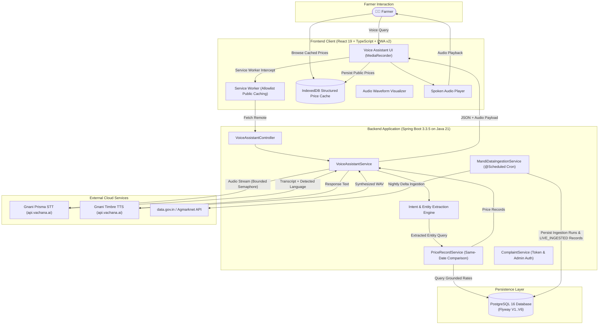
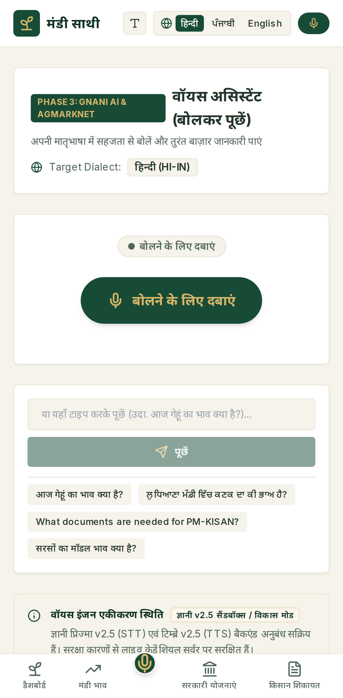
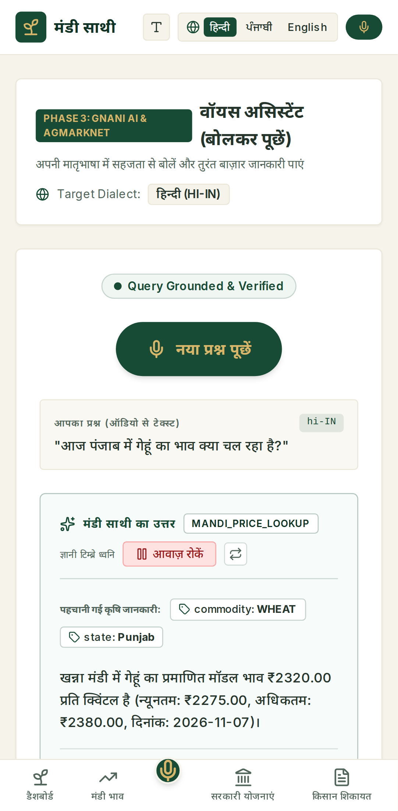
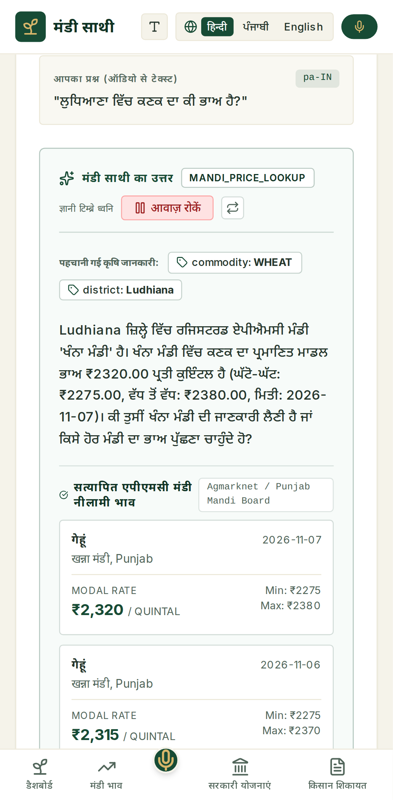
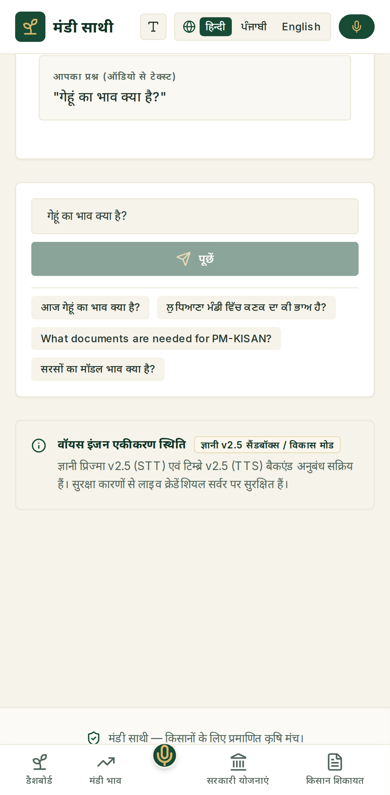

# MandiSaathi (मंडी साथी / ਮੰਡੀ ਸਾਥੀ)

Multilingual, voice-first agricultural market intelligence platform engineered for Indian farmers.

---

## 1. Project Title and Description

**MandiSaathi** is an enterprise-grade agricultural market intelligence platform designed to eliminate information asymmetry in Indian agricultural produce marketing. The platform pairs regional voice recognition in Hindi, Punjabi, and Indian English with verified agricultural market price telemetry from official Agricultural Produce Market Committee (APMC) mandis across India.

---

## 2. Problem Statement

Smallholder and marginal farmers in India produce over 86% of the country's agricultural output but operate at a severe disadvantage when selling produce at local APMC mandis. Primary obstacles include:
- **Literacy and Linguistic Barriers**: Most official price portals and market dashboards are text-heavy and formatted in English or formal administrative Hindi, creating steep usability barriers for rural producers.
- **Inter-Mandi Price Dispersion**: Substantial price arbitrage exists between neighboring mandis (often exceeding ₹100–₹300 per quintal), yet farmers lack real-time comparative visibility before transport.
- **Data Opacity and Extrapolation Risk**: Generic digital tools frequently present extrapolated, unverified, or outdated market averages, leading farmers to negotiate on false price expectations.

---

## 3. Proposed Solution

MandiSaathi resolves these challenges by providing:
1. **Conversational Regional Voice Interface**: Farmers query mandi prices by speaking naturally in their local dialect (Hindi, Punjabi, or English) via browser audio recording.
2. **Deterministic Data Grounding**: Voice queries are mapped to verified database filings ingested from the official Agmarknet catalog (`data.gov.in`). Prices are never synthesized, estimated, or fabricated.
3. **Domain-Specific Safeguards**: The system enforces district-aware location resolution (preventing silent substitution of markets), comparative data sufficiency guards (requiring at least two markets reporting on the same auction date), and missing-data transparency.
4. **Natural Audio Synthesis**: Factual market responses are synthesized into fluent, dialect-accurate spoken audio using Gnani.ai's Timbre TTS engine.

---

## 4. Key Features

- **Voice Assistant**: Multipart audio streaming, real-time audio visualizer, automatic language detection (`hi-IN`, `pa-IN`, `en-IN`), entity extraction (Commodity, District, Mandi, State), and spoken audio playback.
- **Mandi Price Intelligence**: Multi-dimensional filtering by crop category, state, district, and APMC yard, displaying modal, minimum, and maximum prices alongside reported arrival volumes.
- **Mandi Comparison**: Cross-mandi arbitrage spread calculator (₹/quintal) with comparative visual bar charts rendered via Recharts.
- **Government Schemes Directory**: Catalog of major welfare programs (PM-KISAN, PMFBY, Soil Health Card, e-NAM, Kisan Credit Card) detailing eligibility criteria, documentation, and official portal links.
- **Farmer Grievance Logging**: Structured grievance intake tracking APMC irregularities (unauthorized deductions, weighing disputes) with unique tracking reference numbers (`MS-2026-XXXXX`).
- **High-Visibility Accessibility**: Font-scaling toggle (`normal` vs `large`) and responsive layouts optimized for mobile devices operating under outdoor sunlight.

---

## 5. Target Users

- **Smallholder Farmers**: Seeking rapid, voice-driven price discovery before transporting produce to market.
- **Farmer Producer Organizations (FPOs)**: Analyzing price spreads to aggregate and dispatch bulk produce to optimal regional mandis.
- **Agricultural Extension Workers & Krishi Vigyan Kendras (KVKs)**: Advising local farmers on fair market values and government schemes.
- **Rural Traders & Commission Agents**: Referencing official APMC daily benchmark rates.

---

## 6. Technology Stack

| Layer | Technology | Version | Purpose |
| :--- | :--- | :--- | :--- |
| **Backend Runtime** | Java | 21 (LTS) | Core application platform |
| **Backend Framework** | Spring Boot | 3.3.5 | REST controllers, services, security |
| **Database** | PostgreSQL | 16-alpine | Relational persistence |
| **Database Migrations** | Flyway | 10.x | Schema versioning (V1 through V6) |
| **Frontend Runtime** | React | 19.0.0 | Single-page presentation layer |
| **Language** | TypeScript | 5.7.2 | Static type safety |
| **Build Tooling** | Vite | 6.0.0 | Frontend compilation & bundling |
| **PWA & Offline** | Service Worker & IndexedDB | W3C Standard (v2) | Offline app shell, public price caching, stale warning |
| **Styling** | Tailwind CSS | 3.4.17 | Agricultural design system styling |
| **State Management** | TanStack Query | 5.60.0 | Server state caching & invalidation |
| **Voice AI (STT)** | Gnani Prisma STT | v2.5 / v3.0 | Cloud speech-to-text transcription (10 Indic languages) |
| **Voice AI (TTS)** | Gnani Timbre TTS | v2.5 / v3.0 | Cloud text-to-speech voice synthesis |
| **Data Source** | data.gov.in (OGD) | Agmarknet Feed | Official daily APMC auction prices |
| **Containerization** | Docker & Compose | 24+ / Compose v2 | Multi-container orchestration |

---

## 7. System Architecture



---

## 8. Voice Processing Workflow

1. **Audio Capture**: The browser records user speech via `navigator.mediaDevices.getUserMedia` and the `MediaRecorder` API in standard WAV or WebM containers.
2. **Audio Streaming**: Audio is uploaded via multipart form data (`POST /api/v1/voice/audio`) along with an optional language locale hint.
3. **Prisma STT Transcription**: The backend passes the audio binary directly to `https://api.vachana.ai/stt/v3` using RestClient with the `X-API-Key-ID` header, receiving the transcribed text and detected language (`hi-IN`, `pa-IN`, `en-IN`).
4. **Entity Extraction & Grounding**: The NLP engine normalizes vernacular terms (e.g., *कनक*, *गेहूँ*, *गेहूं* $\rightarrow$ `WHEAT`) and checks location entities.
5. **District-Aware Resolution**: A query mentioning a district (such as Ludhiana) queries all registered APMCs within that district. If Khanna Mandi is the single registered yard, the assistant discloses this and asks for confirmation rather than silently defaulting.
6. **Timbre TTS Synthesis**: Factual response text is synthesized via `https://api.vachana.ai/api/v1/tts/inference`, generating a 16kHz linear PCM WAV stream.
7. **Client Playback**: The audio is returned as a Base64-encoded WAV string, which the client decodes and plays immediately.

---

## 9. Gnani AI Integration & Multilingual Architecture

MandiSaathi uses a single `GNANI_API_KEY` authenticated via the `X-API-Key-ID` header:

| Engine | Endpoint URL | Model | Voices & Locales | Concurrency Controls |
| :--- | :--- | :--- | :--- | :--- |
| **Prisma STT** | `https://api.vachana.ai/stt/v3` | `prisma-v2.5` | 10 Indian Languages (`hi`, `pa`, `en`, `bn`, `gu`, `kn`, `ml`, `mr`, `ta`, `te`) | Bounded Semaphore (5 permits), 3s acquire timeout, upstream 429 `Retry-After` backoff |
| **Timbre TTS** | `https://api.vachana.ai/api/v1/tts/inference` | `timbre-v2.5` | `Nalini` (Hindi, Punjabi, Marathi, Bengali, Tamil, Telugu)<br>`Kaveri` (Indian English, Kannada) | Linear PCM 16kHz WAV streaming |

In offline or sandbox development mode, the application falls back to `GnaniSttStubService` and `GnaniTtsStubService`, generating synthetic 16kHz WAV tones labeled as **`Local Sandbox Synthetic Audio`**. User voice transcripts are scrubbed from production logs (only latency, character count, and confidence scores are retained).

---

## 10. Mandi Data Integration & Provenance Integrity

- **Data Provider**: Open Government Data (OGD) Platform India (`data.gov.in`).
- **Resource ID**: `9ef84268-d588-465a-a308-a864a43d0070` (Daily Mandi Prices of Various Commodities Across India).
- **Strict Ingestion Validation**:
  - **Date Authenticity**: Missing or unparseable arrival dates are rejected immediately; dates are never replaced with `LocalDate.now()`.
  - **Price Relationship Integrity**: Strictly verifies $\text{min\_price} \le \text{modal\_price} \le \text{max\_price}$ and $\text{price} > 0$. Inverted, zero, or negative prices are discarded with structured error logging—never mutated, inverted, or clamped.
  - **Composite Market Matching**: Normalized against market name, district, and state together with 24 Indian state mappings. Incomplete market records are rejected.
- **Provenance Distinction**:
  - `SEEDED_BASELINE`: 15 initial benchmark records across 8 APMC mandis preserved for offline baselines.
  - `LIVE_INGESTED`: Verified records ingested from official upstream feeds. Live ingestion never silently overwrites seeded baseline records.
- **Variety Support**: Accommodates multiple crop varieties (e.g., Sharbati vs Lokwan Wheat) via composite uniqueness `(commodity_code, mandi_code, price_date, variety)`.
- **Sanitized Execution Runs**: Ingestion histories store sanitized exception summaries without exposing upstream API keys or raw stack traces.
- **Same-Date Mandi Comparison**: Comparing prices across mandis requires all selected yards to report on a common auction date. When dates diverge, the system transparently indicates insufficient common-date data rather than calculating false arbitrage spreads across different days.
- **Manual Sync**: Available via `POST /api/v1/prices/sync`.

---

## 11. Database Architecture & Migrations

Database schema versioning is managed via Flyway across 6 structured migrations:
- **`V1__initial_schema.sql`**: Core tables: `commodities`, `mandis`, and `price_records`.
- **`V2__phase2_schema.sql`**: Extended tables: `government_schemes` and `complaints`.
- **`V3__phase3_mandi_pipeline.sql`**: Ingestion runs table and composite deduplication index.
- **`V4__phase4_audit_indexes.sql`**: High-performance indexes for commodity, mandi, and date lookups.
- **`V5__phase5c_provenance_and_variety.sql`**: Adds `variety` and `provenance_type` columns to price records.
- **`V6__phase5e_variety_constraint_and_complaint_security.sql`**:
  - Replaces price unique constraint with `uk_price_commodity_mandi_date_variety` on `(commodity_code, mandi_code, price_date, variety)`.
  - Adds unguessable 128-bit `tracking_token VARCHAR(64) NOT NULL` to `complaints` for secure, private grievance tracking.

```sql
-- Production Price Record Table
CREATE TABLE price_records (
    id BIGSERIAL PRIMARY KEY,
    commodity_code VARCHAR(64) NOT NULL REFERENCES commodities(code),
    mandi_code VARCHAR(64) NOT NULL REFERENCES mandis(code),
    min_price NUMERIC(10,2) NOT NULL,
    max_price NUMERIC(10,2) NOT NULL,
    modal_price NUMERIC(10,2) NOT NULL,
    price_date DATE NOT NULL,
    arrival_quantity NUMERIC(12,2),
    variety VARCHAR(64) NOT NULL DEFAULT 'Standard / FAQ',
    provenance_type VARCHAR(32) NOT NULL DEFAULT 'LIVE_INGESTED',
    unit VARCHAR(32) NOT NULL DEFAULT 'QUINTAL',
    data_source VARCHAR(128) NOT NULL DEFAULT 'Agmarknet / data.gov.in',
    verified BOOLEAN NOT NULL DEFAULT TRUE,
    created_at TIMESTAMP WITH TIME ZONE NOT NULL DEFAULT CURRENT_TIMESTAMP,
    CONSTRAINT uk_price_commodity_mandi_date_variety UNIQUE (commodity_code, mandi_code, price_date, variety)
);
```

---

## 12. API Endpoint Documentation

| Method | URI Path | Access Level | Purpose |
| :--- | :--- | :--- | :--- |
| `GET` | `/api/v1/health` | Public | Subsystem health, live provenance status, and service connectivity |
| `GET` | `/actuator/health` | Public | Standard Spring Boot Actuator probe |
| `POST` | `/api/v1/voice/query` | Public | Vernacular text query processing and speech synthesis |
| `POST` | `/api/v1/voice/audio` | Public | Multipart audio voice query processing (STT $\rightarrow$ Grounding $\rightarrow$ TTS) |
| `GET` | `/api/v1/prices` | Public | Query verified price records by `commodityCode` and `mandiCode` |
| `POST` | `/api/v1/prices/compare` | Public | Strict same-date multi-mandi price arbitrage comparison |
| `POST` | `/api/v1/prices/sync` | Public | Trigger synchronization with official `data.gov.in` feed |
| `GET` | `/api/v1/commodities` | Public | List verified agricultural commodities |
| `GET` | `/api/v1/mandis` | Public | List verified APMC market yards (supports `?state=Punjab`) |
| `GET` | `/api/v1/schemes` | Public | Search and retrieve government schemes |
| `POST` | `/api/v1/complaints` | Public (Throttled) | Register grievance; returns reference number, masked phone, & unguessable tracking token |
| `GET` | `/api/v1/complaints/{ref}?token={token}` | Private / Token | Track grievance status securely using reference number and unguessable token |
| `GET` | `/api/v1/complaints` | Admin Only | Full grievance registry (requires `X-Admin-Key` header; HTTP 403 Forbidden without key) |

*For complete payload and response schemas, see [`docs/api-reference.md`](docs/api-reference.md).*

---

## 13. Screenshots Section

Mobile responsive screenshots captured during automated Playwright Android Pixel 7 testing:

| Initial Viewport | Live Hindi Query Result |
| :---: | :---: |
|  |  |
| *Clean agricultural UI with mobile bottom navigation* | *Verified price card with Live Gnani audio playback* |

| Punjabi District Resolution | Throttled 3G Network Resilience |
| :---: | :---: |
|  |  |
| *Non-silent Ludhiana to Khanna Mandi resolution* | *Graceful rendering under simulated rural 3G throttling* |

---

## 14. Installation Instructions

### Prerequisites
- **Java Development Kit**: JDK 21+ (`openjdk 21`)
- **Node.js**: v20+ or v22+
- **Docker & Compose**: Docker Engine 24+ with Compose v2
- **Git**

```bash
# Clone the repository
git clone https://github.com/Ritesh7009/MandiSaathi.git
cd mandisaathi
```

---

## 15. Environment Configuration

Copy the example configuration to `.env`:
```bash
cp .env.example .env
```
Edit `.env` to configure your credentials:
```ini
# To enable live Gnani AI voice capabilities:
GNANI_ENABLED=true
GNANI_API_KEY=your_gnani_api_key_here

# Administrative key for grievance registry management:
ADMIN_API_KEY=your_secure_admin_key_here
```

---

## 16. Local Development Instructions

### 1. Launch PostgreSQL Container
```bash
docker compose up -d postgres
```

### 2. Launch Backend
```bash
cd backend
set -a && source ../.env && set +a
./mvnw spring-boot:run
```
Backend starts on: `http://localhost:8080`.

### 3. Launch Frontend
```bash
cd frontend
npm install
npm run dev -- --host
```
Frontend runs on: `http://localhost:5173`.

---

## 17. Docker Setup

To build and run the entire platform within isolated Docker containers:
```bash
# Build and start all three containers
docker compose up --build -d

# Verify container statuses
docker compose ps
```
- **Frontend**: `http://localhost:5173`
- **Backend**: `http://localhost:8080/api/v1/health`
- **PostgreSQL**: `localhost:5433`

---

## 18. Testing Instructions

MandiSaathi includes comprehensive automated test suites:

```bash
# 1. Run all backend JUnit/MockMvc tests (58 tests: security, provenance, same-date comparison, concurrency)
cd backend && ./mvnw test

# 2. Run frontend TypeScript static validation
cd frontend && npx tsc --noEmit

# 3. Compile frontend production bundle
cd frontend && npm run build

# 4. Multi-stage Docker container build
docker build -t mandisaathi-backend:phase5e ./backend
```

---

## 19. Security & Privacy Architecture

- **Server-Side Secret Isolation**: Third-party API keys (`GNANI_API_KEY`, `DATA_GOV_IN_API_KEY`, `ADMIN_API_KEY`) reside exclusively on the backend and are never exposed in browser bundles.
- **Farmer Grievance Privacy & Enumeration Protection**:
  - Full grievance registry access (`GET /api/v1/complaints`) requires administrative authentication via `X-Admin-Key` header (HTTP 403 Forbidden without valid key).
  - Public status lookup (`GET /api/v1/complaints/{ref}?token={token}`) strictly requires a matching unguessable 128-bit cryptographic tracking token generated upon registration.
  - Personal telephone numbers are masked (`******5678`) in all public responses.
  - Submission rate limiting throttles requests to 20 submissions per IP per minute.
  - Browser clients store recent grievances locally in `localStorage`, allowing farmers to check status privately on their own device without public enumeration risks.
- **Offline Cache Privacy (Service Worker v2)**:
  - Cache storage strictly allowlists public agricultural datasets (`/api/v1/commodities`, `/mandis`, `/prices`, `/schemes`).
  - Grievance submissions, tracking endpoints, and audio streams are explicitly blocked from offline caches.
- **Voice Privacy & Production Telemetry**:
  - Raw speech transcripts and user voice queries are scrubbed from production logs.
  - Telemetry retains only request latency, character counts, and model confidence scores.
- **Voice Concurrency Controls**:
  - Speech transcription bounded by a configurable `Semaphore` (default 5 concurrent permits) with queue timeouts, preventing resource exhaustion.
  - Upstream HTTP 429 rate limits automatically respect `Retry-After` headers.
- **SQL Injection Prevention**: All queries execute via Spring Data JPA and Hibernate with parameterized binding.
- **Strict CORS Protection**: Access restricted to trusted frontend origin domains; wildcard origins with credentials are explicitly prohibited.

---

## 20. Known Limitations

- **Reporting Dates vs Real-Time Auctions**: Mandi prices reflect daily closed auction records filed with APMC market committees, not real-time continuous stock-ticker feeds.
- **Same-Date Arbitrage Requirement**: Multi-mandi price comparison requires all selected mandis to have reported on a common auction date. If reporting dates diverge, the system indicates insufficient common-date data rather than misleading farmers with cross-date spreads.
- **Offline Voice Processing Boundary**: Real-time voice recognition (Prisma STT) and voice synthesis (Timbre TTS) require an active network connection to Gnani.ai. When offline, price intelligence remains accessible via structured IndexedDB cache with clear reporting dates and stale warnings, while voice features cleanly display connectivity notices.
- **Baseline Seed Scope**: The verified baseline seed tracks 15 benchmark APMC records across 8 mandis (preserved as `SEEDED_BASELINE`). Live upstream feeds are stored as `LIVE_INGESTED` and never overwrite seeded baselines.
- **Legal Scope of Grievances**: The tracking identifier issued by MandiSaathi (`MS-2026-XXXXX`) is an internal reference number for community advocacy and is **not** an official Government of India CPGRAMS docket acknowledgement.

*For complete details, see [`docs/known-limitations.md`](docs/known-limitations.md).*

---

## 21. Future Scope

- **Direct e-NAM Integration**: Bid placement and trade settlement directly through National Agriculture Market portals.
- **Indic Language Expansion**: Voice recognition and synthesis support for Marathi, Gujarati, Telugu, and Kannada.
- **Automated Weather & Logistics Optimization**: Integrating local weather forecasts and transport route costs into mandi arbitrage recommendations.

---

## 22. Acknowledgements & Data Attribution

- **Ministry of Agriculture & Farmers Welfare, Government of India**: For open access to daily market arrival data via Agmarknet and the Open Government Data (OGD) Platform India (`data.gov.in`).
- **Gnani.ai**: For providing state-of-the-art Indic speech models (Prisma STT and Timbre TTS).
- **APMC Market Committees**: For daily collation of agricultural market prices across India.
