# MandiSaathi — Premium Editorial UI/UX Redesign Roadmap & Blueprint

> **Architecture Standard:** Production-grade, Editorial Indian AgriTech.  
> **Aesthetic Philosophy:** Anti-AI-slop, high-sunlight outdoor contrast, tactile farmer ergonomics, zero generic AI clichés.  
> **Methodology:** Elephant-Goldfish Multi-Agent Swarm (`egm-design`, `egm-style`, `egm-structural`, `egm-zoom-out`).  
> **Non-Negotiable Guardrails:** **Zero functionality breakage**, zero mock/hallucinated data, preserve all working APIs, IndexedDB offline caching, Gnani STT/TTS voice loop, and 10-language localizations.

---

## 1. Executive Summary & Design Read

### A. The Design Read (via `taste-skill`)
*"Reading this as: Indian Agricultural Intelligence Platform for farmers, rural traders, and APMC market participants, with a trust-first, editorial, high-sunlight-contrast language, leaning toward authentic agricultural tones (deep forest green, warm harvest ochre/sand, crisp parchment, clean typography, zero AI purple gradients, zero fake sparkles, zero generic cards)."*

### B. Core Calibration Dials
* **`DESIGN_VARIANCE: 5`** — Editorial, structured, calm, trustworthy. Avoids wild asymmetric chaos or cookie-cutter templates.
* **`MOTION_INTENSITY: 4`** — Tactile, restrained, smooth 60fps micro-interactions with hardware-accelerated transforms (`transform`, `opacity`). Zero dizzying infinite loops.
* **`VISUAL_DENSITY: 5`** — High legibility in direct sunlight, minimum $48\times 48\text{px}$ touch targets for mobile touchscreens, crisp tabular numbers (`tabular-nums`) for currency and arrivals.

---

## 2. Component Adoption Matrix from Reference Sites

We integrate specific, high-craft components from the specified reference libraries into MandiSaathi:

| Reference Source | Selected Component / Pattern | Where Used in MandiSaathi | How It Elevates UI/UX |
| :--- | :--- | :--- | :--- |
| **`motion-primitives.com`** | **`NumberTicker` / Rolling Numeric Counter** | Modal Price, Min/Max Spreads, Arrival Volumes | Prices transition with a smooth spring counter rather than jarring text jumps when changing mandis or crops. |
| **`motion-primitives.com`** | **`MorphingCard` / Expandable Item** | Mandi Cards & Government Scheme Cards | Expands inline to reveal historical price trends, arrival grades, and required documents without disruptive page jumps. |
| **`motion-primitives.com`** | **`SpringTabs` / Sliding Pill Indicator** | 4-Destination Navigation & Dialect Selector | A smooth spring-sliding indicator follows active tabs (`layoutId="activeTab"`), eliminating rigid button borders. |
| **`motion-primitives.com`** | **`TextShimmer` / Subtle Scan** | Voice Assistant Recording/Processing State | Subtle harvest-gold shimmer replaces jarring spinners during STT transcription and TTS audio synthesis. |
| **`ui.watermelon.sh`** | **Tactile High-Contrast Badges** | Data Provenance Badges (`Verified APMC`, `Agmarknet OGD`, `Offline Cached`) | Clean, micro-bordered badges with high contrast for outdoor daylight legibility. |
| **`ui.watermelon.sh`** | **Refined Tabular Data Grid** | Price Intelligence Screen (`PriceIntelligence.tsx`) | Subtle hairline dividers, fixed column alignments, and sticky headers for effortless multi-crop scanning. |
| **`cult-ui.com`** | **Spotlight Border Card** | Benchmark Mandi Cards & Suggested Query Chips | Micro-spotlight radial gradient on card borders (`#174B35` / `#D7B66A`) that reacts subtly to cursor/touch. |
| **`cult-ui.com`** | **Organic Paper Grain Texture** | App Background Canvas (`#FAF9F5`) | Subtle CSS SVG noise overlay gives a tactile, premium physical bond-paper texture, erasing the "flat plastic AI" feel. |
| **`cult-ui.com`** | **Mobile Bottom Action Sheet** | Mandi & Commodity Filters Drawer | Smooth swipe-to-dismiss bottom sheet for filters on mobile viewports. |
| **`skiper-ui.com`** | **Ergonomic Voice Studio Centerpiece** | Home Page (`Home.tsx`) | Circular acoustic dock with live dynamic 16-bar frequency spectrum and spring-scale microphone button. |
| **`threeui.com` / `threejs.org`** | **Topographical Agricultural Contour Mesh** | Hero Section Ambient Backdrop | Lightweight, hardware-accelerated Canvas/Three.js rendering undulating soil terrace/topographic contours. Capped at 30/60fps with instant static SVG fallback for low-power mobile devices. |
| **`designeer.xyz`** | **Editorial Typography & Hierarchy** | Global Layouts, Spacing & Headings | Clean typography pairing with strict matra clearance for Indic scripts (`Noto Sans Devanagari`, `Noto Sans Gurmukhi`, `Inter`). |

---

## 3. Skills & Plugins Deployment Strategy

| Tool / Skill / Plugin | Purpose & Application |
| :--- | :--- |
| **`taste-skill`** | Strict pre-flight checks: bans AI purple gradients, generic cards, floating glassmorphism, and robotic marketing copy. |
| **`ui-ux-pro-max`** | Accessibility auditing: enforces $\ge 4.5:1$ contrast ratio for text and $\ge 3:1$ for borders, $48\text{px}$ minimum mobile touch targets, and sunlight-safe color palette. |
| **`ui-styling`** | Tailwind CSS utility-first refactoring, component specifications, and accessible Radix UI primitives. |
| **`micro-interaction`** | Tactile button press feedback (`active:scale-95`), smooth hover states, and drawer transitions. |
| **`60fps-animation`** | Eliminates layout thrashing, forces GPU-accelerated compositing (`transform`, `opacity`), and handles `prefers-reduced-motion`. |
| **`gsap-animation`** | High-precision timelines for voice visualizer and data transitions. |
| **`threejs-animation`** | Ambient terrain contour canvas with visibility-based throttling and zero memory leaks. |
| **`elephant-goldfish-plugin`** | Multi-agent continuous verification: `egm-design` (hostile design critic), `egm-style` (technical copy editor), `egm-structural` (grid and document validator), `egm-zoom-out` (minimalist architect). |

---

## 4. Screen-by-Screen Execution Plan (Zero Feature Breakage)

```mermaid
graph TD
    A["Screen 1: Home (Farmer Interaction Hub)"] --> B["1. Skiper Voice Dock + Topographic Contour Canvas"]
    A --> C["2. Motion-Primitives Spring Dialect Selector (10 Langs)"]
    A --> D["3. Watermelon Tactile Benchmark Pulse Cards"]
    
    E["Screen 2: Mandi Prices (Price Intelligence)"] --> F["1. Cult-UI Spotlight Filter Drawer"]
    E --> G["2. High-Legibility Tabular Data Grid"]
    E --> H["3. NumberTicker Rolling Modal Rates"]
    
    I["Screen 3: Compare Mandis (Price Spread)"] --> J["1. Multi-Mandi Spread Differential Bar"]
    I --> K["2. Morphing Comparison Cards"]
    I --> L["3. Insufficient Data Warning Card"]
    
    M["Screen 4: More (Welfare & Services)"] --> N["1. Minimalist Accordion for Schemes"]
    M --> O["2. Clean Grievance Registration"]
    M --> P["3. System Telemetry & Offline Cache"]
```

### Detailed Screen Improvements:

### Screen 1: Home (`Home.tsx`)
1. **Topographical Ambient Mesh (inspired by `threejs.org` / `threeui.com`):**
   - Subtle animated contour lines in the background representing agricultural soil contours.
   - Throttled, pauses when out of view, and has zero impact on voice latency or mobile performance.
2. **Acoustic Voice Studio (inspired by `skiper-ui.com`):**
   - Organic circular microphone centerpiece with tactile spring feedback.
   - 16-bar responsive audio level visualizer.
   - Text shimmer state during STT transcription.
3. **Dialect Fast Selector (inspired by `motion-primitives.com`):**
   - Smooth animated sliding pill for the 10 Gnani AI languages (`hi`, `pa`, `en`, `mr`, `gu`, `bn`, `te`, `ta`, `kn`, `ml`).
4. **Market Pulse Cards (inspired by `ui.watermelon.sh`):**
   - Clean benchmark prices with rolling `NumberTicker`, reporting dates, and official provenance badges.

### Screen 2: Mandi Prices (`PriceIntelligence.tsx`)
1. **Filter Controls:**
   - State, district, and commodity search with clean dropdowns and clear active filter tags.
   - Mobile-optimized bottom drawer inspired by `cult-ui.com`.
2. **Tabular & Card Price Grid:**
   - High-contrast numbers (`tnum` / `tabular-nums`).
   - Explicit distinction between verified Agmarknet closed-auction data and offline cached records.
   - 10-second rate-limited manual sync button with clear progress indicators.

### Screen 3: Compare Mandis (`MandiComparison.tsx`)
1. **Interactive Comparison Header:**
   - Multi-mandi selection pills with clear check indicators.
2. **Visual Price Spread Bar:**
   - High-contrast horizontal spread bar showing highest mandi, lowest mandi, and exact difference in ₹/quintal.
3. **Insufficient Data Guard:**
   - Clear, respectful banner if fewer than 2 mandis reported on the same date.

### Screen 4: More (`More.tsx`)
1. **Government Schemes:**
   - Clean expandable accordion cards (`motion-primitives.com`) detailing eligibility, documents, and application steps.
2. **Grievance Registration:**
   - Streamlined farmer grievance form with instant reference code generation (`GRV-...`).
3. **Settings & Offline Storage:**
   - Storage usage indicators, cache clearance with confirmation, and dialect preferences.

---

## 5. Non-Negotiable Implementation Constraints

1. **Zero Functional Breakage:**
   - Every API call (`/api/v1/voice/query`, `/api/v1/voice/audio`, `/api/v1/prices`, `/api/v1/mandis`, `/api/v1/commodities`, `/api/v1/sync`, `/api/v1/schemes`) remains identical.
   - IndexedDB offline caching and PWA service worker continue to function without interruption.
2. **Zero Fake Data or AI Hallucination:**
   - All displayed prices originate from PostgreSQL records or verified Agmarknet baseline data.
   - Daily closed-auction prices are never labeled as "live telemetry".
3. **100% 10-Language Support:**
   - All components must continue using `t(...)`, `getCommodityName(...)`, and `getMandiName(...)`.
   - Native Indic scripts (`Noto Sans Devanagari`, `Noto Sans Gurmukhi`, Tamil, Telugu, Kannada, Malayalam, Bengali, Gujarati) must maintain proper line-height and matra clearance.
4. **Zero AI Slop:**
   - No purple/violet gradients, no sparkle icons, no generic robotic buzzwords, no nested glass cards.

---

## 6. Verification Protocol

After implementation:
1. **TypeScript & Production Build:** `npx tsc --noEmit` and `npm run build` must succeed with 0 errors.
2. **Backend Integrity:** `./mvnw test` across all 39 test suites must pass.
3. **Automated Playwright Browser Suite:** End-to-end user journeys executed and verified across desktop and mobile viewports with screenshots captured.

