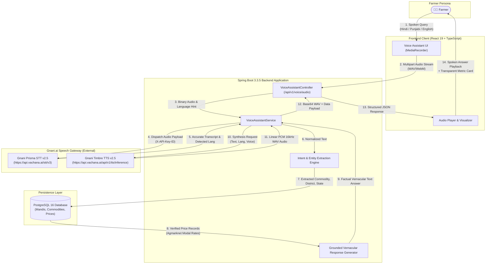
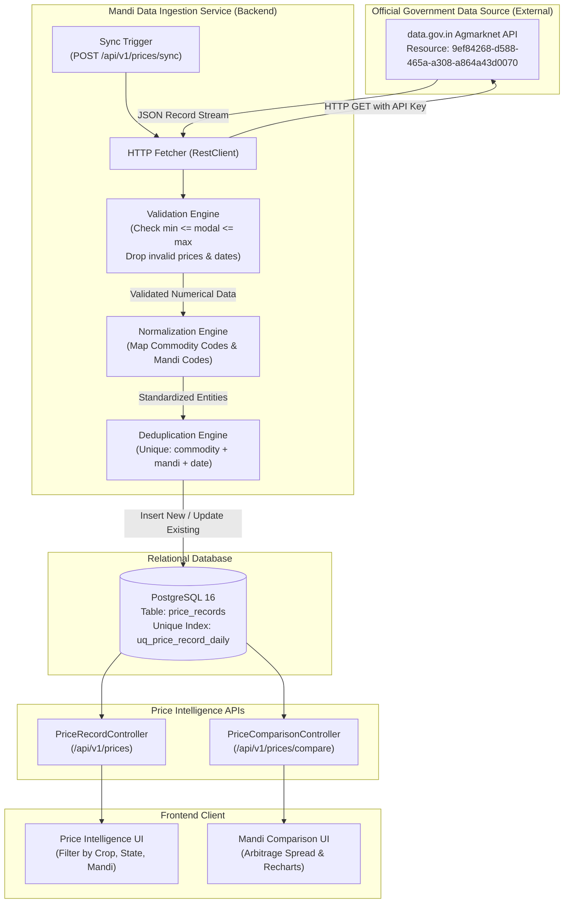

# MandiSaathi — System Architecture Specification

## 1. Executive Architecture Summary

MandiSaathi is a voice-first, multilingual agricultural intelligence platform engineered to bridge the digital divide for Indian farmers. The system provides natural voice interactions in regional Indic languages (Hindi, Punjabi, English) and pairs speech understanding with grounded agricultural market telemetry from verified APMC mandis.

The platform architecture follows clean separation of concerns:
- **Presentation Layer**: React 19 single-page application with TypeScript, Tailwind CSS, and localized interfaces.
- **Application Layer**: Spring Boot 3.3.5 backend on Java 21, providing conversational orchestration, entity extraction, data ingestion, and RESTful APIs.
- **Speech Engine Layer**: Integration with Gnani.ai's Prisma STT (speech-to-text) and Timbre TTS (text-to-speech) via authenticated REST APIs.
- **Persistence Layer**: PostgreSQL 16 relational database with schema versioning managed via Flyway migrations (V1, V2, V3).
- **External Integration Layer**: Open Government Data (OGD) Platform India (`data.gov.in` / Agmarknet) daily price feeds.

---

## 2. End-to-End Voice Processing Workflow

The diagram below details the conversational pipeline. Every user interaction traverses the secure boundary between client, application server, voice AI engines, and the relational database.

### Key Workflow Principles
1. **Zero Client Secrets**: The frontend never communicates directly with Gnani or `data.gov.in`. All third-party credentials reside exclusively within the Spring Boot environment.
2. **Deterministic Grounding**: The voice engine does not synthesize price figures autonomously. Response text is constructed from verified database filings before being submitted to Gnani Timbre for voice synthesis.
3. **Graceful Fallbacks**: If upstream STT or TTS encounters an outage, the system reports transparent statuses (`FAILED` or `STUBBED`) and enables local browser speech synthesis without terminating the application.

---

## 3. Mandi Data Ingestion Pipeline

The data ingestion pipeline acquires, validates, normalizes, and stores daily agricultural commodity arrivals from the official Agmarknet catalog via `data.gov.in`.

### Ingestion Validation Rules:
- **Price Bounds Enforcement**: Every incoming record must satisfy `min_price <= modal_price <= max_price`. If inverted values are supplied by the upstream feed, min and max are swapped, and modal price is clamped to the range.
- **Date Standardization**: Incoming dates in formats `dd/MM/yyyy`, `yyyy-MM-dd`, or `dd-MM-yyyy` are normalized to ISO-8601 `LocalDate` (`YYYY-MM-DD`).
- **Composite Deduplication**: Enforced at the database constraint level via Flyway migration `V3__phase3_mandi_pipeline.sql` on `(commodity_code, mandi_code, price_date)`. Duplicate filings for the same auction day update existing rates rather than creating redundant entries.

---

## 4. Multi-Layer Component Architecture

### Frontend Layer (React 19 + TypeScript + Vite)
- **State Management**: React Context (`LanguageContext`) managing vernacular switching across Hindi, Punjabi, and English; TanStack Query (`@tanstack/react-query`) managing server state and cache invalidation.
- **Component Hierarchy**:
  - `Header`: Navigation, language selector, connectivity status indicator.
  - `Sidebar` & `MobileBottomNav`: Desktop and mobile navigation.
  - `VoiceAssistant`: Audio recording, frequency visualizer, conversational history, and audio playback.
  - `PriceIntelligence`: Multi-filter criteria selection and tabular display of verified modal prices.
  - `MandiComparison`: Comparative arbitrage spread calculator and Recharts bar charts.
  - `GovernmentSchemes`: Searchable directory of central and state agricultural schemes.
  - `ComplaintRegistration`: Two-step farmer grievance intake form with tracking number generation.
  - `Settings`: High-visibility font sizing toggle and dialect preferences.

### Backend Layer (Spring Boot 3.3.5 on Java 21)
- **Controllers**:
  - `HealthController`: Exposes `/api/v1/health` reporting status of database, Gnani STT, Gnani TTS, and data source.
  - `VoiceAssistantController`: Exposes `/api/v1/voice/query` and `/api/v1/voice/audio`.
  - `PriceRecordController`: Exposes `/api/v1/prices`, `/api/v1/prices/sync`, and `/api/v1/prices/compare`.
  - `CommodityController` & `MandiController`: Reference master data catalogs.
  - `GovernmentSchemeController`: Scheme catalog search and detail retrieval.
  - `ComplaintController`: Grievance submission and lookup by reference number.
- **Service Layer**:
  - `VoiceAssistantService`: Implements intent determination (`MANDI_PRICE_LOOKUP`, `MANDI_COMPARISON`, `COMMODITY_SEARCH`, `GENERAL_HELP`), entity extraction, district-aware location resolution, and response generation.
  - `GnaniSttServiceImpl` / `GnaniTtsServiceImpl`: Production HTTP clients integrating with `api.vachana.ai` using RestClient.
  - `GnaniSttStubService` / `GnaniTtsStubService`: Offline sandbox fallback generating synthetic 16kHz PCM audio for credential-free development.
  - `MandiDataIngestionService`: Ingests and normalizes live Agmarknet market data.

### Database Layer (PostgreSQL 16)
- **Entity Tables**:
  - `commodities`: Code, category, default unit, localized names (`name_en`, `name_hi`, `name_pa`).
  - `mandis`: APMC yard code, localized names, district, state, latitude, longitude, active flag.
  - `price_records`: Foreign keys to commodity and mandi, min/max/modal prices, price date, data source, verification status.
  - `government_schemes`: Code, title, category, benefit description, eligibility criteria, required documents, official portal URL.
  - `complaints`: Unique reference number (`MS-YYYY-XXXXX`), farmer details, category, description, status, resolution date.

---

## 5. Security & Isolation Boundaries

1. **Environment Segregation**: Sensitive keys (`GNANI_API_KEY`, `DATA_GOV_IN_API_KEY`) are managed strictly through environment variables loaded on server startup and never included in Git version control.
2. **Stateless CORS Policy**: Spring Security restricts cross-origin access to configured origin domains (`http://localhost:5173`, `http://localhost:3000`).
3. **Database Parameterization**: All database access executes through Spring Data JPA / Hibernate using parameterized SQL queries, eliminating SQL injection vulnerabilities.
4. **Input Size Guardrails**: Audio uploads are capped at 15 MB in `GnaniSttServiceImpl` to prevent memory exhaustion and denial-of-service attempts.
