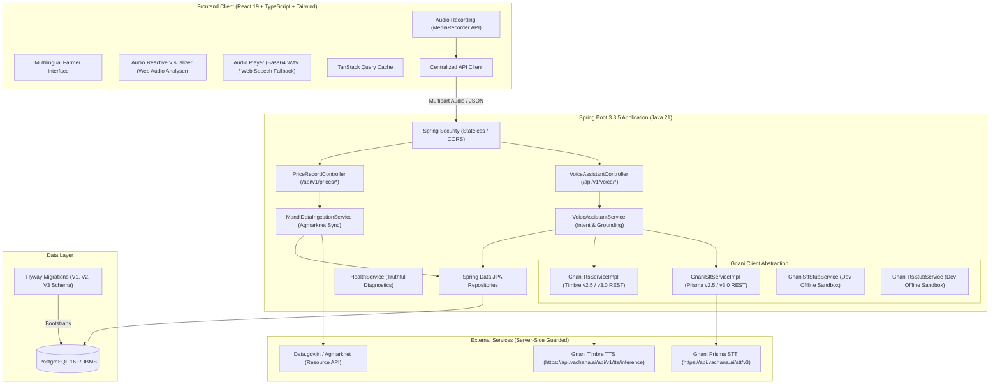
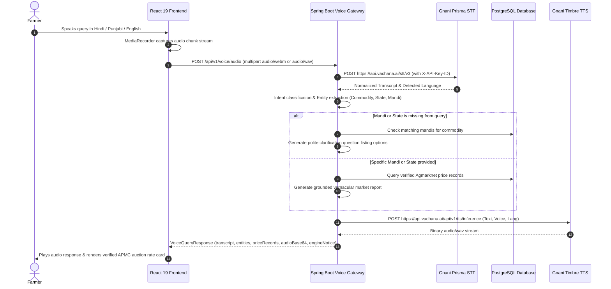

# MandiSaathi (मंडी साथी / ਮੰਡੀ ਸਾਥੀ) — Architecture Specification
**Phase 3: Real Gnani AI Integration and Verified Mandi Data Pipeline**

## 1. System Overview

MandiSaathi is a production-grade, multilingual, voice-first agricultural intelligence platform engineered for Indian farmers. Agricultural decision-making demands high trust, strict data provenance, regional language accessibility, and low-latency voice interactions.

---

## 2. Voice AI Pipeline (Gnani Prisma & Timbre)

The end-to-end voice query lifecycle follows strict grounding and security constraints:

### Security & Operational Rules:
1. **Zero Secret Exposure**: All `GNANI_API_KEY`, `GNANI_TOKEN`, and `DATA_GOV_IN_API_KEY` credentials reside exclusively server-side in Spring Boot environment variables. No tokens are accessible in React or Vite code.
2. **Offline Development Sandbox**: When `GNANI_API_KEY` is not configured or `gnani.enabled=false`, the backend seamlessly operates `GnaniSttStubService` and `GnaniTtsStubService`, allowing full local testing without network flakiness.
3. **Truthful Diagnostics**: The `/api/v1/health` endpoint reports actual component statuses (`NOT_CONFIGURED`, `CONFIGURED`, `CONNECTED`, `DEGRADED`, `FAILED`, `STUBBED`).

---

## 3. Verified Mandi Data Pipeline (`data.gov.in` / Agmarknet)

### Architecture:
* **Service**: `MandiDataIngestionService`
* **Trigger Endpoint**: `POST /api/v1/prices/sync`
* **External Provider**: OGD Platform India (`data.gov.in`) Agmarknet current daily prices resource (`9ef84268-d588-465a-a308-a864a43d0070`).
* **Ingestion Integrity**:
  * Resolves commodities via uppercase code matching and alias mapping (`WHEAT`, `MUSTARD`, `PADDY`, `ONION`, etc.).
  * Resolves mandis via name and state normalization, auto-registering active markets if new.
  * Enforces price constraint: `min_price <= modal_price <= max_price`.
  * Deduplication via database unique constraint on `(commodity_code, mandi_code, price_date)` with upsert semantics (`insertedCount`, `updatedCount`, `skippedCount`).
  * Telemetry tag: `dataSource = 'Agmarknet (data.gov.in API)'` and `verified = true`.

---

## 4. Database Schema & Flyway Versioning

* **V1__initial_schema.sql**: Initial `commodities` and `mandis` reference registries.
* **V2__phase2_schema.sql**: Added `price_records`, `government_schemes`, and `complaints` tables with initial seed data.
* **V3__phase3_mandi_pipeline.sql**:
  * Adds unique constraint `uk_price_commodity_mandi_date` on `price_records(commodity_code, mandi_code, price_date)`.
  * Adds composite index `idx_price_records_commodity_date` on `price_records(commodity_code, price_date DESC)` for fast vernacular query resolution.

---

## 5. Frontend Architecture & Multi-Dialect UI

* **State Machine in `VoiceAssistant.tsx`**:
  `idle` → `recording` → `transcribing` → `processing` → `generating_audio` → `answered`, plus `permission_denied` and `error`.
* **Audio-Reactive Visualizer**: Skiper UI and Motion Primitives inspired concentric radar rings and frequency bars driven by browser `AudioContext` and `AnalyserNode`.
* **Audio Player**: Native base64 WAV playback for Gnani Timbre speech synthesis, with seamless fallback to browser `SpeechSynthesisUtterance`.
* **Localization**: Complete coverage for Hindi (`hi-IN` / Devanagari), Punjabi (`pa-IN` / Gurmukhi), and English (`en-IN` / Latin).
