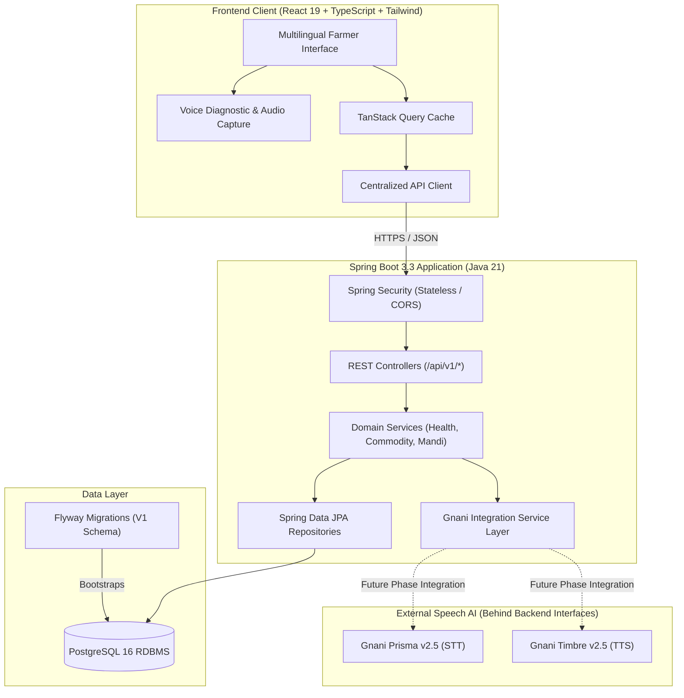

# MandiSaathi (मंडी साथी) — Architecture Specification
**Phase 1: Project Foundation**

## 1. System Overview

MandiSaathi is a production-grade, multilingual, voice-first agricultural intelligence platform engineered for Indian farmers. Agricultural decision-making demands high trust, strict data provenance, regional language accessibility, and low-latency voice interactions.



---

## 2. Frontend Architecture

* **Framework**: React 19 with strict-mode TypeScript and Vite bundler.
* **State & Data Fetching**: TanStack Query (`@tanstack/react-query`) provides optimistic caching, background re-validation, and declarative loading/error states.
* **Routing**: React Router with modular page routing and custom 404 fallbacks.
* **Design System & Theme**:
  * **Forest Green** (`#174B35`): Trust, agriculture, vitality. Primary navigation, buttons, brand marks.
  * **Harvest Gold** (`#D7B66A`): Maturity, prosperity, grain harvest. Badges, active highlights, diagnostic accents.
  * **Warm Ivory** (`#F5F3EA`): High-legibility paper-like neutral background avoiding harsh stark white.
  * **Charcoal** (`#25352C`): Deep organic text color providing contrast without absolute black.
* **Typography**:
  * Primary: `Inter`
  * Devanagari: `Noto Sans Devanagari` (for Hindi)
  * Gurmukhi: `Noto Sans Gurmukhi` (for Punjabi)
* **Accessibility & Usability**: Clean typography hierarchy without gratuitous drop shadows, heavy cards, or non-functional controls.

---

## 3. Backend Architecture

* **Runtime**: OpenJDK 21 (LTS) on Spring Boot 3.3.
* **Package Structure**:
  ```text
  com.mandisaathi/
  ├── config/          # Security, CORS, Properties, Gnani Config
  ├── controller/      # REST API Controllers (/api/v1/health, /commodities, /mandis)
  ├── service/         # Domain business logic & transaction boundaries
  ├── repository/      # Spring Data JPA Repository interfaces
  ├── entity/          # JPA Entities (Commodity, Mandi)
  ├── dto/             # Immutable record transfer objects & error models
  ├── client/gnani/    # Abstract service interfaces & clean stubs for Gnani Prisma & Timbre
  └── exception/       # Global exception handler & custom domain exceptions
  ```
* **Security**:
  * Spring Security filter chain configured in stateless mode.
  * CSRF disabled for stateless REST endpoints.
  * Granular CORS configuration driven by `CORS_ALLOWED_ORIGINS`.
* **Validation & Error Handling**:
  * Jakarta Bean Validation (`@NotBlank`, `@NotNull`, etc.).
  * Centralized `@RestControllerAdvice` emitting standardized JSON responses (`status`, `error`, `message`, `path`, `timestamp`, `validationErrors`).

---

## 4. Voice AI Architecture (Gnani Prisma & Timbre)

In accordance with strict architectural rules:
1. **Never expose API keys in frontend code**: Voice requests pass through backend gateway endpoints.
2. **Keep Gnani behind service interfaces**:
   * `GnaniSttService` abstracts speech-to-text transcription.
   * `GnaniTtsService` abstracts text-to-speech synthesis.
3. **Never invent undocumented endpoints**: In Phase 1, clean, typed interfaces and mock-safe stubs (`GnaniSttStubService`, `GnaniTtsStubService`) are provided until real production credentials and payloads are wired in subsequent phases.

---

## 5. Database Schema & Flyway Strategy

* **Engine**: PostgreSQL 16
* **Migration Tool**: Flyway
* **Migration Files**:
  * Location: `backend/src/main/resources/db/migration/` and `database/migrations/`
  * `V1__initial_schema.sql`:
    * Table `commodities`: Standard catalog of Indian agricultural produce with English, Hindi, and Punjabi nomenclature.
    * Table `mandis`: Standard registry of agricultural markets across primary northern and central agricultural hubs (Punjab, Haryana, Rajasthan, Madhya Pradesh, Maharashtra, UP, Delhi).

---

## 6. Engineering & Agricultural Governance Rules

1. **No Fake Prices**: Live market prices must never be hardcoded or fabricated. In Phase 1, the platform exposes verified commodity and mandi metadata, deliberately deferring price ingestion to official Government APIs (Agmarknet/e-NAM) in subsequent phases.
2. **No Non-Functional Buttons**: Every interactive control performs a real function (e.g. language switching, query refetch, hardware microphone diagnosis, state filtering).
3. **Modular Monorepo**: Simple, single-unit deployability without microservice overhead.

