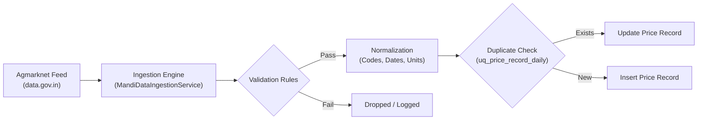

# MandiSaathi — Agricultural Data Pipeline Specification

## 1. Overview & Data Provenance

Reliable agricultural market intelligence demands strict provenance. Price information in MandiSaathi is derived from official APMC (Agricultural Produce Market Committee) daily auction filings, ingested through the Open Government Data (OGD) Platform India (`data.gov.in`).

### Source Dataset Credentials:
- **Publishing Authority**: Directorate of Marketing & Inspection (DMI), Ministry of Agriculture and Farmers Welfare, Government of India.
- **Data Catalog**: *Daily Mandi Prices of Various Commodities Across India (Agmarknet)*.
- **Resource ID**: `9ef84268-d588-465a-a308-a864a43d0070`
- **Data Format**: JSON / REST API
- **Reporting Units**: Indian Rupee per Quintal (₹/qtl), where $1 \text{ Quintal} = 100 \text{ Kilograms}$.
- **Update Frequency**: Published daily upon completion of morning and afternoon APMC physical auctions (typically updated between 4:00 PM and 7:00 PM IST).

---

## 2. Ingestion & Transformation Lifecycle

The data ingestion process executes through `MandiDataIngestionService` within the Spring Boot application.



### Transformation Steps:

#### Step 1: Ingestion Trigger
- Triggered manually via `POST /api/v1/prices/sync` or automated scheduled background tasks.
- If `MANDI_DATA_ENABLED=false` or no `DATA_GOV_IN_API_KEY` is configured, the system logs the state and retains verified baseline seed filings without simulating fake ingestion.

#### Step 2: Ingestion & Parsing
- Queries `https://api.data.gov.in/resource/9ef84268-d588-465a-a308-a864a43d0070` with request parameters: `api-key`, `format=json`, and `limit`.
- Parses incoming JSON payload extracting fields: `state`, `district`, `market`, `commodity`, `arrival_date`, `min_price`, `max_price`, and `modal_price`.

#### Step 3: Mathematical Bounds Validation
Raw government feeds can contain OCR or manual keypunch anomalies. MandiSaathi applies automated integrity checks:
- **Price Positivity**: `min_price`, `modal_price`, and `max_price` must be strictly positive numeric values. Zero or negative records are skipped.
- **Bounds Inversion Correction**: If an upstream filing provides $\text{min\_price} > \text{max\_price}$, the values are systematically swapped.
- **Modal Value Clamping**: Enforces $\text{min\_price} \le \text{modal\_price} \le \text{max\_price}$. If the modal price lies outside this bracket, it is clamped to the nearest bound.

#### Step 4: Date & Entity Normalization
- Dates are parsed from variable formats (`dd/MM/yyyy`, `yyyy-MM-dd`, `dd-MM-yyyy`) into standard ISO-8601 `LocalDate` objects.
- Commodity names are mapped to standardized uppercase identifiers:
  - `"Wheat"`, `"Gehun"`, `"कनक"` $\rightarrow$ `WHEAT`
  - `"Mustard"`, `"Sarson"`, `"Rapeseed"` $\rightarrow$ `MUSTARD`
  - `"Paddy(Dhan)"`, `"Rice"` $\rightarrow$ `PADDY`
  - `"Onion"` $\rightarrow$ `ONION`
  - `"Cotton"` $\rightarrow$ `COTTON`
  - `"Maize"` $\rightarrow$ `MAIZE`
- Mandis are resolved against the `mandis` table. Unregistered active APMC yards are automatically provisioned with a generated standardized code (e.g. `MARKETNAME_STATE`).

#### Step 5: Database Deduplication
- Database constraint `uq_price_record_daily` on `(commodity_code, mandi_code, price_date)` prevents duplicate filings for the same auction day.
- Existing filings are updated with revised auction figures and marked with source `"Agmarknet (data.gov.in API)"`.
- New filings are inserted as verified records.

---

## 3. Database Schema Specification

### Table: `price_records`
```sql
CREATE TABLE price_records (
    id BIGSERIAL PRIMARY KEY,
    commodity_code VARCHAR(50) NOT NULL REFERENCES commodities(code),
    mandi_code VARCHAR(50) NOT NULL REFERENCES mandis(code),
    min_price NUMERIC(10,2) NOT NULL,
    max_price NUMERIC(10,2) NOT NULL,
    modal_price NUMERIC(10,2) NOT NULL,
    price_date DATE NOT NULL,
    arrival_quantity NUMERIC(10,2),
    unit VARCHAR(20) DEFAULT 'QUINTAL',
    data_source VARCHAR(100) DEFAULT 'Agmarknet / data.gov.in',
    verified BOOLEAN DEFAULT TRUE,
    created_at TIMESTAMP WITH TIME ZONE DEFAULT CURRENT_TIMESTAMP,
    CONSTRAINT uq_price_record_daily UNIQUE (commodity_code, mandi_code, price_date)
);
```

---

## 4. Current Dataset Scope & Baseline Seeds

In the baseline seed migration (`V1__initial_schema.sql` and `V2__phase2_schema.sql`), MandiSaathi includes representative verified APMC filings across northern and central agricultural hubs:

| Mandi Code | Market Name | District | State | Major Tracked Crops |
| :--- | :--- | :--- | :--- | :--- |
| `KHANNA_PB` | Khanna Mandi (Asia's Largest Grain Yard) | Ludhiana | Punjab | Wheat, Paddy, Maize |
| `SIRSA_HR` | Sirsa Mandi | Sirsa | Haryana | Wheat, Mustard, Cotton |
| `KARNAL_HR` | Karnal Mandi | Karnal | Haryana | Wheat, Basmati Paddy |
| `KOTA_RJ` | Kota Mandi | Kota | Rajasthan | Wheat, Mustard, Soybean |
| `NEEMUCH_MP` | Neemuch Mandi | Neemuch | Madhya Pradesh | Wheat, Mustard, Garlic |
| `LASALGAON_MH` | Lasalgaon Mandi | Nashik | Maharashtra | Onion |
| `AZADPUR_DL` | Azadpur Mandi (Major Terminal Hub) | North Delhi | Delhi | Wheat, Onion, Vegetables |
| `HAPUR_UP` | Hapur Mandi | Hapur | Uttar Pradesh | Wheat, Jaggery |

---

## 5. Known Data Limitations
1. **Reporting Date vs Live Auction**: Mandi prices reflect the daily closed auction session as reported by the APMC secretary. They are **not** real-time stock-ticker feeds.
2. **Missing Crop Coverage**: Niche, seasonal, or minor crops (e.g., medicinal plants, regional pulses) may not report daily auctions during off-season periods.
3. **Mandi Geographic Scope**: While the schema accommodates all 2,700+ APMCs across India, the current local verification baseline focuses on 8 major primary and terminal markets across Punjab, Haryana, Rajasthan, MP, Maharashtra, UP, and Delhi.

---

## 6. Automated Scheduling, Ingestion History & Offline Caching (Phase 4B)

### A. Spring Boot `@Scheduled` Ingestion Cron
To support automated nightly synchronization of official Agmarknet auction bulletins, the platform provides automated scheduling anchored to Indian Standard Time (`Asia/Kolkata`):
- **Cron Expression**: `0 0 19 * * *` (Daily at 7:00 PM IST, following the close and filing of evening APMC auctions).
- **Configuration Toggle**: Configurable via `MANDI_DATA_SCHEDULE_ENABLED=true/false` (default: `false` for development safety).
- **Concurrency Guard**: Synchronized via thread-safe `AtomicBoolean isSyncRunning`. If a manual sync is executing, scheduled cron executions gracefully skip rather than creating overlapping write contention.

### B. Ingestion Run Audit Table (`ingestion_runs`)
Every ingestion execution (manual or scheduled) is persistently tracked in PostgreSQL:
```sql
CREATE TABLE ingestion_runs (
    id BIGSERIAL PRIMARY KEY,
    started_at TIMESTAMP WITH TIME ZONE NOT NULL,
    completed_at TIMESTAMP WITH TIME ZONE,
    status VARCHAR(50) NOT NULL, -- SUCCESS, FAILED, SKIPPED, IN_PROGRESS
    total_fetched INT DEFAULT 0,
    inserted_count INT DEFAULT 0,
    updated_count INT DEFAULT 0,
    skipped_count INT DEFAULT 0,
    message TEXT,
    error_details TEXT,
    triggered_by VARCHAR(50) NOT NULL, -- MANUAL_SYNC, SCHEDULED_CRON
    created_at TIMESTAMP WITH TIME ZONE DEFAULT CURRENT_TIMESTAMP
);
```

### C. Client-Side Offline Caching (IndexedDB)
When rural internet connectivity is unavailable, the frontend serves cached price intelligence stored in browser IndexedDB:
- **Database**: `mandisaathi_offline_db`
- **Object Stores**: `price_records`, `commodities`, `mandis`, `metadata`
- **Freshness Window**: 24 hours (86,400,000 ms). Records older than 24 hours render with an explicit **Stale Data Warning (>24 hrs)** badge.
- **Reporting Attribution**: Every offline record visibly displays its official APMC auction date and last synchronized client timestamp.


