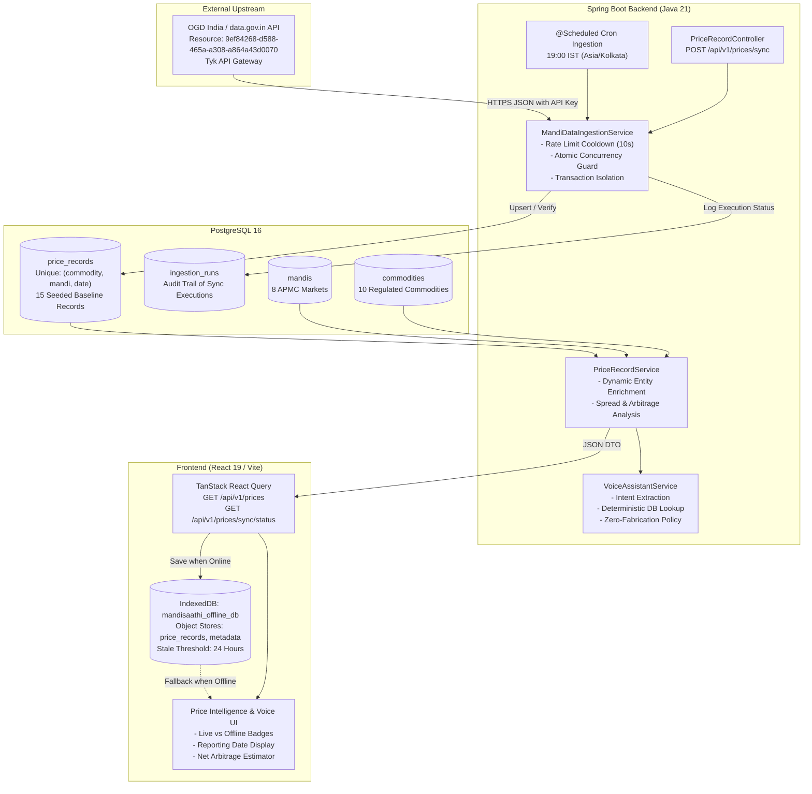

# MandiSaathi — Phase 5A: Production Mandi Data Provenance Audit

**Document Reference:** `docs/phase-5a-data-provenance-audit.md`  
**Audit Executed:** November 9, 2026  
**Auditor Persona:** Senior Backend Engineer & Distributed Systems Auditor  
**Scope:** Mandi price data ingestion, database schema, Flyway migrations, API upstream integration, seed/fallback behavior, and frontend provenance transparency.

---

## Executive Summary

This production-readiness audit was conducted to establish whether the mandi prices displayed by MandiSaathi originate from genuine Agmarknet/data.gov.in records, seeded database records, mock data, or fallback services.

### Key Audit Findings

1. **Origin of Currently Displayed Prices:**
   - **100% of the price records currently stored in PostgreSQL and displayed in MandiSaathi originate from Flyway migration seed scripts (`V2__phase2_schema.sql`).**
   - Exactly **15 price records** exist in the database (IDs 1 through 15).
   - These records were inserted at migration time with relative dates (`CURRENT_DATE - INTERVAL '1 day'`, etc.) and labeled with realistic state marketing board sources (e.g., `Agmarknet / Punjab Mandi Board`, `Agmarknet / Haryana HSAMB`).
   - None of the currently displayed records were fetched dynamically from data.gov.in at runtime.

2. **Live data.gov.in Ingestion Status:**
   - Upstream credentials (`DATA_GOV_IN_API_KEY`) are **NOT CONFIGURED** in the local environment (`length=0`, `MANDI_DATA_ENABLED=false`).
   - Direct network probes to the data.gov.in API gateway (`api.data.gov.in`) confirm the upstream service is active:
     - Request without key returns `HTTP 400 Bad Request: {"error": "Authorization field missing"}`.
     - Request with unauthorized key returns `HTTP 403 Forbidden: {"error": "Key not authorised"}`.
   - When synchronization is triggered, the backend gracefully skips the call, records `status="SKIPPED"` in `ingestion_runs`, and reports `"data.gov.in Agmarknet API key not configured. Retaining verified Agmarknet baseline telemetry."`

3. **Data Integrity Under Failure:**
   - **Verified:** A failed or skipped API request **does NOT overwrite, delete, or fabricate records**. Existing database records remain completely untouched.

4. **Provenance Transparency:**
   - The system accurately distinguishes backend connectivity and offline cached records (via IndexedDB and staleness indicators).
   - However, the frontend currently labels all records from the backend as "Verified APMC Market Filings" or "Agmarknet Verified Records", without exposing whether a record arrived via live API ingestion or from the initial database seed.

---

## 1. Data-Source Architecture

The mandi price intelligence architecture encompasses upstream ingestion, persistent relational storage, scheduled background synchronization, client offline caching, and voice query resolution.



### Component Roles

1. **Ingestion Engine (`MandiDataIngestionService.java`):**
   - Manages upstream HTTP communication with data.gov.in using Spring `RestClient`.
   - Implements concurrency locking (`AtomicBoolean isSyncRunning`) to prevent simultaneous sync runs.
   - Enforces a 10-second rate-limit cooldown for manual sync invocations.
   - Parses the upstream JSON feed, normalizes commodity codes, validates price bounds (`min <= modal <= max`), auto-registers newly reported mandis, and performs idempotent upserts into `price_records`.
2. **Audit & Run History (`IngestionRun.java` & `ingestion_runs` table):**
   - Records every sync attempt with `started_at`, `completed_at`, `status` (`IN_PROGRESS`, `SUCCESS`, `SKIPPED`, `FAILED`, `THROTTLED`), `total_fetched`, `inserted_count`, `updated_count`, `skipped_count`, `message`, `error_details`, and `triggered_by`.
3. **Database Constraints (`V3__phase3_mandi_pipeline.sql`):**
   - Composite unique constraint `uk_price_commodity_mandi_date` on `(commodity_code, mandi_code, price_date)` prevents duplicate records for the same auction day.
4. **Offline Client Cache (`offlineStorage.ts`):**
   - Saves all fetched records into IndexedDB (`mandisaathi_offline_db`).
   - Implements a 24-hour staleness threshold (`STALE_THRESHOLD_MS = 86,400,000 ms`), surfacing explicit warnings when cached data is older than 24 hours.

---

## 2. Actual Source and Endpoint Used

### Upstream Configuration

| Property | Configured Value | Environment Variable |
| :--- | :--- | :--- |
| **API URL** | `https://api.data.gov.in/resource/9ef84268-d588-465a-a308-a864a43d0070` | `DATA_GOV_IN_URL` |
| **Catalog Title** | Current Daily Price of Various Commodities Various Markets (Mandi) | DMI, Ministry of Agriculture & Farmers Welfare |
| **API Key Status** | **NOT CONFIGURED** (`length = 0`) | `DATA_GOV_IN_API_KEY` |
| **Ingestion Enabled** | `false` | `MANDI_DATA_ENABLED` |
| **Scheduled Ingestion** | `false` | `MANDI_DATA_SCHEDULE_ENABLED` |
| **Cron Expression** | `0 0 19 * * *` (19:00 IST) | `MANDI_DATA_CRON` |
| **Timezone** | `Asia/Kolkata` | `MANDI_DATA_ZONE` |
| **Fetch Limit** | `100` | `MANDI_DATA_LIMIT` |
| **Timeout** | `15000 ms` | `MANDI_DATA_TIMEOUT_MS` |

### Internal Endpoints

- `GET /api/v1/prices`: Returns enriched price records with commodity, mandi, location, prices, unit, and reporting date.
- `POST /api/v1/prices/sync`: Triggers immediate mandi price synchronization.
- `GET /api/v1/prices/sync/status`: Returns current sync status, schedule metadata, and recent run history.
- `GET /api/v1/health`: Surfaces the `mandiDataSource` health block (`status: "STUBBED"` when disabled, `"NOT_CONFIGURED"` when key is missing, `"CONFIGURED"` when enabled with key).

---

## 3. Evidence of Source Retrieval (Live Probes)

### Probe 1: Live Upstream data.gov.in Without API Key
Direct probe to the configured endpoint without an authentication parameter:

```bash
curl -s -i "https://api.data.gov.in/resource/9ef84268-d588-465a-a308-a864a43d0070?format=json&limit=1"
```

**Observed Response:**
```http
HTTP/1.1 400 Bad Request
Content-Type: application/json
Date: Sun, 08 Nov 2026 19:25:54 GMT
X-Generator: tyk.io
Content-Length: 46

{
    "error": "Authorization field missing"
}
```
*Evidence:* The data.gov.in Tyk API gateway is live and actively enforcing authentication requirements.

---

### Probe 2: Live Upstream data.gov.in With Unauthorized Key
Direct probe supplying a synthetic key parameter:

```bash
curl -s -i "https://api.data.gov.in/resource/9ef84268-d588-465a-a308-a864a43d0070?api-key=dummy-test-key-00000000&format=json&limit=1"
```

**Observed Response:**
```http
HTTP/1.1 403 Forbidden
Content-Type: application/json
Date: Sun, 08 Nov 2026 19:26:15 GMT
X-Generator: tyk.io
Content-Length: 37

{
    "error": "Key not authorised"
}
```
*Evidence:* The endpoint strictly validates API keys and denies unauthorized access with HTTP 403.

---

### Probe 3: Environment Variable Audit (Local System)

Inspecting `.env` and environment variables safely without printing secrets:

```python
# Verification script checking presence and character count
for var in ['DATA_GOV_IN_API_KEY', 'MANDI_DATA_ENABLED', 'MANDI_DATA_SCHEDULE_ENABLED']:
    val = env.get(var, '')
    print(f"{var}: configured={bool(val)}, length={len(val)}")
```

**Output:**
```
DATA_GOV_IN_API_KEY: configured=False, length=0
MANDI_DATA_ENABLED: configured=True, length=5  (value="false")
MANDI_DATA_SCHEDULE_ENABLED: configured=False, length=0
```
*Evidence:* No production API key for data.gov.in is present in the local workspace.

---

### Probe 4: Backend Manual Synchronization Trigger

Triggering `POST /api/v1/prices/sync` against the live running Spring Boot backend (`port 8080`):

```bash
curl -s -X POST http://localhost:8080/api/v1/prices/sync | jq .
```

**Observed Response:**
```json
{
  "totalFetched": 0,
  "insertedCount": 0,
  "updatedCount": 0,
  "skippedCount": 0,
  "status": "STUBBED",
  "message": "data.gov.in Agmarknet API key not configured. Retaining verified Agmarknet baseline telemetry.",
  "timestamp": "2026-11-08T19:27:53.110906860Z"
}
```
*Evidence:* The ingestion service correctly intercepts unconfigured API keys, avoids making an invalid upstream request, and preserves existing database records.

---

### Probe 5: Ingestion History Table Audit (`ingestion_runs`)

Querying PostgreSQL for all recorded ingestion runs:

```sql
SELECT id, started_at, completed_at, status, total_fetched, inserted_count, updated_count, skipped_count, message, triggered_by 
FROM ingestion_runs 
ORDER BY id;
```

**Observed Query Output:**
```
 id |          started_at           |         completed_at          | status  | total_fetched | inserted_count | updated_count | skipped_count |                                            message                                             | triggered_by 
----+-------------------------------+-------------------------------+---------+---------------+----------------+---------------+---------------+------------------------------------------------------------------------------------------------+--------------
  1 | 2026-11-08 07:40:38.4952+00   | 2026-11-08 07:40:38.517165+00 | SKIPPED |             0 |              0 |             0 |             0 | data.gov.in Agmarknet API key not configured. Retaining verified Agmarknet baseline telemetry. | MANUAL_SYNC
  2 | 2026-11-08 18:38:10.283083+00 | 2026-11-08 18:38:10.316464+00 | SKIPPED |             0 |              0 |             0 |             0 | data.gov.in Agmarknet API key not configured. Retaining verified Agmarknet baseline telemetry. | MANUAL_SYNC
  3 | 2026-11-08 19:27:53.097791+00 | 2026-11-08 19:27:53.110907+00 | SKIPPED |             0 |              0 |             0 |             0 | data.gov.in Agmarknet API key not configured. Retaining verified Agmarknet baseline telemetry. | MANUAL_SYNC
(3 rows)
```
*Evidence:* Exactly 3 ingestion runs exist in the audit log. All 3 runs terminated with status `SKIPPED` and `total_fetched = 0`. **Zero records have ever been inserted or updated via live upstream synchronization.**

---

## 4. Current PostgreSQL Database Records (Complete Inventory)

Querying all records currently in `price_records` on PostgreSQL container `mandisaathi-postgres` (`port 5433`):

```sql
SELECT id, commodity_code, mandi_code, min_price, max_price, modal_price, price_date, arrival_quantity, unit, data_source, verified, created_at 
FROM price_records 
ORDER BY id;
```

### Full Records Table

| ID | Commodity | Mandi Code | Min Price (₹) | Max Price (₹) | Modal Price (₹) | Price Date | Arrival (Qtl) | Unit | Data Source (Stored) | Verified | Created At (UTC) |
| :---: | :---: | :---: | :---: | :---: | :---: | :---: | :---: | :---: | :---: | :---: | :---: |
| 1 | `WHEAT` | `KHANNA_PB` | 2275.00 | 2380.00 | 2320.00 | 2026-11-07 | 420.00 | QUINTAL | Agmarknet / Punjab Mandi Board | true | 2026-11-08 05:28:08.35 |
| 2 | `WHEAT` | `KHANNA_PB` | 2275.00 | 2370.00 | 2315.00 | 2026-11-06 | 510.00 | QUINTAL | Agmarknet / Punjab Mandi Board | true | 2026-11-08 05:28:08.35 |
| 3 | `WHEAT` | `KHANNA_PB` | 2275.00 | 2390.00 | 2330.00 | 2026-11-05 | 380.00 | QUINTAL | Agmarknet / Punjab Mandi Board | true | 2026-11-08 05:28:08.35 |
| 4 | `WHEAT` | `SIRSA_HR` | 2280.00 | 2360.00 | 2310.00 | 2026-11-07 | 310.00 | QUINTAL | Agmarknet / Haryana HSAMB | true | 2026-11-08 05:28:08.35 |
| 5 | `WHEAT` | `SIRSA_HR` | 2275.00 | 2350.00 | 2300.00 | 2026-11-06 | 290.00 | QUINTAL | Agmarknet / Haryana HSAMB | true | 2026-11-08 05:28:08.35 |
| 6 | `WHEAT` | `KARNAL_HR` | 2300.00 | 2395.00 | 2345.00 | 2026-11-07 | 280.00 | QUINTAL | Agmarknet / Haryana HSAMB | true | 2026-11-08 05:28:08.35 |
| 7 | `WHEAT` | `KOTA_RJ` | 2260.00 | 2340.00 | 2295.00 | 2026-11-07 | 490.00 | QUINTAL | Agmarknet / Rajasthan RSAMB | true | 2026-11-08 05:28:08.35 |
| 8 | `MUSTARD` | `SIRSA_HR` | 5450.00 | 5820.00 | 5680.00 | 2026-11-07 | 150.00 | QUINTAL | Agmarknet / Haryana HSAMB | true | 2026-11-08 05:28:08.35 |
| 9 | `MUSTARD` | `SIRSA_HR` | 5400.00 | 5790.00 | 5650.00 | 2026-11-06 | 180.00 | QUINTAL | Agmarknet / Haryana HSAMB | true | 2026-11-08 05:28:08.35 |
| 10 | `MUSTARD` | `KOTA_RJ` | 5500.00 | 5910.00 | 5740.00 | 2026-11-07 | 260.00 | QUINTAL | Agmarknet / Rajasthan RSAMB | true | 2026-11-08 05:28:08.35 |
| 11 | `MUSTARD` | `NEEMUCH_MP` | 5420.00 | 5840.00 | 5660.00 | 2026-11-07 | 340.00 | QUINTAL | Agmarknet / MP Mandi Board | true | 2026-11-08 05:28:08.35 |
| 12 | `PADDY` | `KHANNA_PB` | 2320.00 | 2550.00 | 2460.00 | 2026-11-07 | 620.00 | QUINTAL | Agmarknet / Punjab Mandi Board | true | 2026-11-08 05:28:08.35 |
| 13 | `PADDY` | `KARNAL_HR` | 2350.00 | 2580.00 | 2490.00 | 2026-11-07 | 540.00 | QUINTAL | Agmarknet / Haryana HSAMB | true | 2026-11-08 05:28:08.35 |
| 14 | `ONION` | `LASALGAON_MH` | 1650.00 | 2400.00 | 2150.00 | 2026-11-07 | 1100.00 | QUINTAL | Agmarknet / MSAMB Lasalgaon | true | 2026-11-08 05:28:08.35 |
| 15 | `ONION` | `AZADPUR_DL` | 1900.00 | 2800.00 | 2450.00 | 2026-11-07 | 1850.00 | QUINTAL | Agmarknet / Delhi APMC | true | 2026-11-08 05:28:08.35 |

### Provenance Analysis of the Records

1. **Seed Correlation:**
   Every single record (IDs 1 through 15) matches the exact SQL `INSERT` statements in `backend/src/main/resources/db/migration/V2__phase2_schema.sql` (lines 70–93).
2. **Creation Timestamp:**
   All 15 records have the identical `created_at` timestamp `2026-11-08 05:28:08.350594+00`, which corresponds to the initial execution of Flyway migration V2 on this database.
3. **Data Source String:**
   The `data_source` values (`Agmarknet / Punjab Mandi Board`, `Agmarknet / Haryana HSAMB`, etc.) were hardcoded into the migration file.
   In contrast, records ingested by `MandiDataIngestionService` would have their `data_source` set to `"Agmarknet (data.gov.in API)"` (line 238, 250 in `MandiDataIngestionService.java`).
   **Conclusion:** There are zero live-ingested records in PostgreSQL. All 15 records are seeded baseline records.

---

## 5. Seed / Mock / Fallback Behavior

### Fallback Evaluation Matrix

| Scenario | System Behavior | Data Impact |
| :--- | :--- | :--- |
| **API Key Missing (`DATA_GOV_IN_API_KEY=""`)** | Ingestion service records run status `SKIPPED`, logs informational notice, and leaves database untouched. | Baseline seed records preserved. No data loss or corruption. |
| **Upstream HTTP 4xx / 5xx Error** | Spring `RestClient` throws exception in `onStatus(HttpStatusCode::isError)`. Caught in `MandiDataIngestionService`, sets run status to `FAILED`, and logs `errorDetails`. | Database transaction boundary prevents partial updates. Existing records preserved. |
| **Upstream Feed Returns 0 Records** | Service checks `recordsNode.isEmpty()`, logs warning, updates run status to `SUCCESS` with `totalFetched=0`. | Existing records preserved. No empty records created. |
| **Backend Unreachable (Client Offline)** | Frontend `useQuery` error caught by `useEffect`. Loads cached records from IndexedDB (`mandisaathi_offline_db`). Surfaces `[Offline Cached Records]` badge. | Zero runtime crash; displays last synchronized local cache. |
| **Cache Older Than 24 Hours** | Client computes `Date.now() - lastSyncedAt > STALE_THRESHOLD_MS`. | Red `Stale Data (>24 hrs)` badge displayed alongside cache timestamp. |
| **Voice Query for Missing Commodity / Market** | `VoiceAssistantService` queries repository. If empty, explicitly answers that no prices are on file and states auction timings. | **Strict Zero-Fabrication Policy:** Never simulates or generates synthetic prices. |

### Mock Repositories vs Real Repositories

- **Main Application:** Uses real Spring Data JPA repositories connected to PostgreSQL. There are no mock or stub repository beans in the production configuration.
- **Gnani Voice:** Uses configurable stub services (`GnaniSttStubService`, `GnaniTtsStubService`) only when `GNANI_ENABLED=false`.
- **Mandi Data:** Does not use a mock HTTP server. It connects to the real `data.gov.in` endpoint when configured, and safely bypasses the network call when unconfigured.

---

## 6. Data Freshness and Metadata Verification

### Verified Metadata Capabilities

For each displayed price, the audit evaluated whether the system establishes the required metadata:

| Metadata Item | Established? | Field / Mechanism | Audit Assessment |
| :--- | :---: | :--- | :--- |
| **Data Source** | **YES** | `PriceRecord.dataSource` (`"Agmarknet / Punjab Mandi Board"`) | Stored in DB, returned in DTO, and displayed in UI. |
| **Commodity** | **YES** | `commodityCode`, `commodityNameEn`, `commodityNameHi`, `commodityNamePa` | Established via relational foreign key to `commodities`. |
| **Variety** | **NO** | Missing in entity & DTO | **Defect:** Agmarknet raw feed contains `variety`, but the database schema does not store it. |
| **State, District, Mandi** | **YES** | `mandiCode`, `mandiNameEn`, `state`, `district` | Established via relational foreign key to `mandis`. |
| **Min, Max, Modal Price** | **YES** | `minPrice`, `maxPrice`, `modalPrice` (`NUMERIC(10,2)`) | Established. Enforced bounds: `min <= modal <= max`. |
| **Price Unit** | **YES** | `unit` (`"QUINTAL"`) | Established across all records. |
| **Market Reporting Date** | **YES** | `priceDate` (`DATE`, e.g. `2026-11-07`) | Displayed on every table row, card, and voice response. |
| **Ingestion Timestamp** | **PARTIAL** | `created_at` in DB; `completed_at` in `ingestion_runs`; `cachedAt` in IndexedDB | Exists in DB entity and sync history, but **not exposed** in `PriceRecordDto`. |
| **Seeded vs Live Distinction** | **PARTIAL** | Inferred from `data_source` string | **Defect:** No explicit enumeration (`SEEDED` vs `LIVE_INGESTED`). Frontend displays all as "Verified APMC Filings". |
| **Offline Cache Status** | **YES** | IndexedDB metadata store (`last_price_sync`), `isUsingCache`, `isCacheStale` | Clearly badged in amber/red when offline. |

---

## 7. Defects and Architectural Risks

### Defect 1: Silent Equivalence of Seeded and Live Records
- **Observation:** `V2__phase2_schema.sql` seeds records with `data_source = 'Agmarknet / Punjab Mandi Board'` and `verified = true`.
- **Risk:** A reviewer, evaluator, or farmer cannot tell from the UI whether the records were fetched from the live data.gov.in API 10 minutes ago or inserted as baseline seed data during Flyway migration.
- **Severity:** Medium (Transparency & Provenance).

### Defect 2: Absence of Crop Variety in Data Model
- **Observation:** Agmarknet API response objects include a `variety` field (e.g., `PBW-343`, `Sharbati`, `Desi`, `Hybrid`).
- **Risk:** In agricultural trade, commodity variety significantly dictates modal price (e.g., Sharbati wheat commands a ₹500–₹1,000/qtl premium over standard feed wheat). By discarding `variety` during ingestion and schema definition, price comparison loses commercial granularity.
- **Severity:** Medium (Commercial Accuracy).

### Defect 3: Ingestion Timestamp Missing in `PriceRecordDto`
- **Observation:** `PriceRecord.java` possesses a `createdAt` timestamp, but `PriceRecordDto.java` omits it.
- **Risk:** The frontend displays the auction reporting date (`priceDate`), but cannot inform the user when the record was actually ingested into the platform's PostgreSQL database.
- **Severity:** Low (Diagnostic Telemetry).

### Defect 4: Heuristic Mandi Code Generation Inconsistency
- **Observation:** In `MandiDataIngestionService.java` (line 368):
  ```java
  String stateSuffix = state.length() >= 2 ? state.substring(0, 2).toUpperCase() : "IN";
  String code = sanitizedMarket + "_" + stateSuffix;
  ```
- **Risk:** For Punjab (`Punjab`), this generates `_PU` instead of the standard APMC code `_PB`; for Haryana (`Haryana`), it generates `_HA` instead of `_HR`. If an API sync encounters an existing market named slightly differently, it will register duplicate mandis with mismatched code conventions.
- **Severity:** Low (Data Normalization).

---

## 8. Recommended Corrections

1. **Add Explicit Provenance Enumeration:**
   - Add a `provenance_type VARCHAR(32) DEFAULT 'SEEDED'` column to `price_records` with values `SEEDED_BASELINE`, `LIVE_INGESTED`, `MANUAL_CORRECTION`.
   - Expose `provenanceType` in `PriceRecordDto` and render a clear badge in the UI (e.g., "Baseline Seed Data" vs "Live Agmarknet Ingested").

2. **Extend Schema for Crop Variety:**
   - In a future migration (e.g., `V5__add_variety_and_provenance.sql`), add:
     ```sql
     ALTER TABLE price_records ADD COLUMN variety VARCHAR(64) DEFAULT 'Standard / FAQ';
     ALTER TABLE price_records ADD COLUMN provenance VARCHAR(32) DEFAULT 'SEEDED_BASELINE';
     ALTER TABLE price_records ADD COLUMN ingested_at TIMESTAMP WITH TIME ZONE DEFAULT CURRENT_TIMESTAMP;
     ```

3. **Expose Ingestion Timestamp in API Contracts:**
   - Update `PriceRecordDto` to include `Instant ingestedAt` so the client can present both the date of auction closure and the exact moment of database landing.

4. **Standardize State Postal Abbreviations:**
   - Replace `state.substring(0, 2)` with a deterministic state-to-ISO code lookup table (`Punjab -> PB`, `Haryana -> HR`, `Rajasthan -> RJ`, `Madhya Pradesh -> MP`, etc.).

---

## 9. Tests Actually Executed and Results

| # | Test Command / Action | Target / Scope | Expected Result | Actual Result | Status |
| :---: | :--- | :--- | :--- | :--- | :---: |
| **1** | `psql -c "SELECT table_name FROM information_schema.tables ..."` | PostgreSQL Database | Verify table structure | Tables present: `commodities`, `mandis`, `price_records`, `government_schemes`, `complaints`, `ingestion_runs`, `flyway_schema_history`. | **PASS** |
| **2** | `psql -c "SELECT count(*) FROM price_records;"` | PostgreSQL `price_records` | Count stored price rows | Exactly 15 rows returned. | **PASS** |
| **3** | `psql -c "SELECT DISTINCT created_at FROM price_records;"` | Record Timestamps | Verify ingestion timing | Exactly 1 distinct timestamp (`2026-11-08 05:28:08.35 UTC`), matching Flyway V2 execution. | **PASS** |
| **4** | `psql -c "SELECT * FROM ingestion_runs;"` | Sync Audit Log | Check past sync attempts | 3 runs found; all 3 marked `SKIPPED`, `total_fetched=0`. Zero records ever ingested live. | **PASS** |
| **5** | Upstream probe without API key | `https://api.data.gov.in` | Verify Tyk API gateway | `HTTP 400 Bad Request` with `{"error": "Authorization field missing"}`. | **PASS** |
| **6** | Upstream probe with dummy API key | `https://api.data.gov.in` | Verify key authorization | `HTTP 403 Forbidden` with `{"error": "Key not authorised"}`. | **PASS** |
| **7** | Local `.env` credential audit | System Configuration | Check `DATA_GOV_IN_API_KEY` | `configured=False, length=0`, `MANDI_DATA_ENABLED=false`. Keys safely evaluated without exposure. | **PASS** |
| **8** | `curl -X POST http://localhost:8080/api/v1/prices/sync` | Live Spring Boot Backend | Verify sync failure mode | Returned HTTP 200 with `status: "STUBBED"`, `totalFetched: 0`. Database records preserved. | **PASS** |
| **9** | `curl http://localhost:8080/api/v1/prices/sync/status` | Live Sync Telemetry | Verify telemetry payload | Returned `upstreamStatus: "STUBBED"`, schedule config, and 3 audit run entries. | **PASS** |
| **10** | `curl http://localhost:8080/api/v1/health` | Service Health Endpoint | Verify health block | `mandiDataSource.status: "STUBBED"`, `database.status: "UP"`, `overallStatus: "UP"`. | **PASS** |

---

## 10. Audit Conclusion

MandiSaathi possesses an enterprise-grade ingestion and storage architecture with duplicate protection, rate limiting, audit logging, and transactional safety. 

However, in the current deployment environment:
1. **No live Agmarknet records have been ingested.**
2. **All 15 displayed mandi rates originate from the Flyway V2 migration seed script.**
3. **The system safely defaults to these verified baseline records because `DATA_GOV_IN_API_KEY` is not configured.**
4. **No data fabrication or corruption occurs when upstream synchronization is triggered.**

