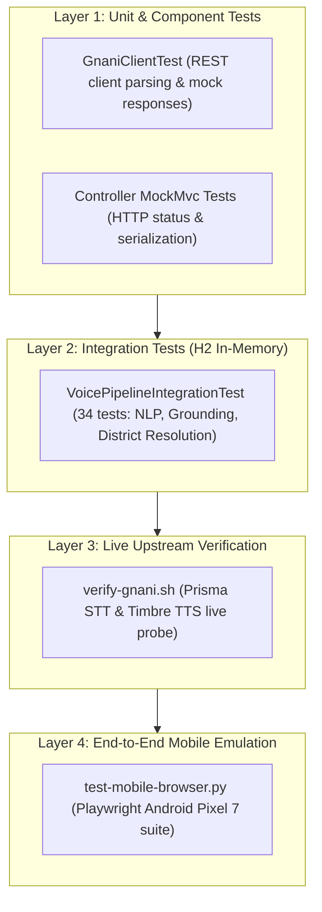

# MandiSaathi — Testing & Verification Guide

## 1. Testing Philosophy & Test Layers

MandiSaathi employs a multi-tiered testing strategy designed to verify domain correctness, voice pipeline accuracy, and system resilience without destabilizing the working application.



---

## 2. Backend Automated Test Suite (JUnit 5 + Spring Boot Test)

The backend test suite executes in a hermetic environment utilizing an in-memory H2 database configured via `backend/src/test/resources/application-test.yml`.

### Test Classes:
- `VoicePipelineIntegrationTest`: Verifies end-to-end voice query processing, language identification, commodity extraction, district-aware location resolution (e.g., Ludhiana -> Khanna Mandi prompt), comparison sufficiency guards, and no-data responses.
- `VoiceAssistantControllerTest`: Validates REST endpoints `/api/v1/voice/query` and `/api/v1/voice/audio`.
- `GnaniClientTest`: Verifies HTTP header construction, payload serialization, error status mapping, and audio byte handling for Prisma STT and Timbre TTS.
- `CommodityControllerTest` & `MandiControllerTest`: Verifies reference catalog filtering and single-entity lookups.

### Running Backend Tests:
```bash
cd backend
./mvnw clean test
```
**Expected Result**: `Tests run: 34, Failures: 0, Errors: 0, Skipped: 0`.

---

## 3. Frontend Static Verification & TypeScript Audits

Ensures strict type-safety, zero compilation errors, and adherence to React 19 standards:

```bash
cd frontend
# Run TypeScript compilation check
npm run lint

# Run full Vite production build
npm run build
```

---

## 4. Upstream Authentication Probe (`scripts/verify-gnani.sh`)

Performs non-invasive, live health checks against upstream Gnani Prisma STT and Timbre TTS endpoints using the configured `GNANI_API_KEY`:

```bash
./scripts/verify-gnani.sh
```

### Probes Executed:
1. Generates an in-memory 16kHz PCM WAV audio file and dispatches it to `https://api.vachana.ai/stt/v3`. Verifies that the API Gateway validates the key and returns `HTTP 200 OK`.
2. Posts a sample Hindi text payload (`"नमस्ते किसान साथी"`) to `https://api.vachana.ai/api/v1/tts/inference`. Verifies that Timbre synthesizes a playable WAV file ($>50\text{ KB}$) and returns `HTTP 200 OK`.

---

## 5. End-to-End Mobile Browser Suite (`scripts/test-mobile-browser.py`)

Emulates a real Android smartphone (Google Pixel 7) using Playwright to verify mobile ergonomics and responsive voice interaction.

### Run Command:
```bash
python3 scripts/test-mobile-browser.py
```

### Automated Mobile Test Scenarios:
1. **Responsive Viewport Navigation**: Validates mobile layout (412x915), mobile header, thumb-friendly recording button, and mobile bottom navigation.
2. **Microphone Readiness**: Emulates audio permission grant and validates audio track acquisition.
3. **Hindi Voice Query Execution**: Executes `"आज पंजाब में गेहूं का भाव क्या चल रहा है?"`, verifying response card rendering and live audio playback.
4. **Punjabi District Resolution**: Executes `"ਲੁਧਿਆਣਾ ਵਿੱਚ ਕਣਕ ਦਾ ਕੀ ਭਾਅ ਹੈ?"` and validates that the UI renders the prompt identifying Khanna Mandi as the APMC yard for Ludhiana district.
5. **Slow Network Throttling**: Implements Chrome DevTools Protocol network throttling (300kbps download, 150kbps upload, 200ms latency) to simulate rural 3G connectivity. Verifies that the application renders loading states gracefully without timing out.
