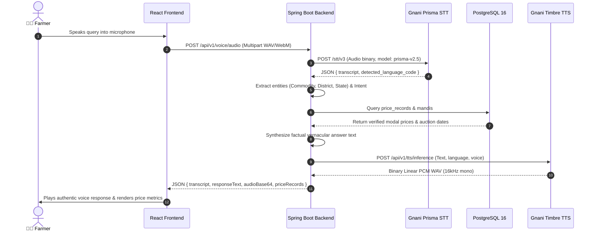

# MandiSaathi — Voice Processing Pipeline Specification

## 1. Overview

The MandiSaathi voice processing pipeline provides low-latency, conversational agricultural intelligence in Hindi (`hi-IN`), Punjabi (`pa-IN`), and English (`en-IN`). It translates raw farmer audio into grounded market insights and speaks the response back in natural regional dialects.

The pipeline comprises six distinct stages:
1. **Audio Acquisition & Streaming** (Browser MediaRecorder)
2. **Speech-to-Text Transcription** (Gnani Prisma STT v2.5)
3. **Intent Recognition & Entity Extraction** (Vernacular NLP Engine)
4. **Contextual Grounding & Business Logic** (District Resolution & Comparison Guards)
5. **Text-to-Speech Voice Synthesis** (Gnani Timbre TTS v2.5)
6. **Audio Playback & Diagnostics** (Base64 WAV streaming & Analyser Visualizer)

---

## 2. Upstream Gnani AI Integration Details

### Authentication Architecture
MandiSaathi uses a unified authentication mechanism where a single `GNANI_API_KEY` grants access to both Prisma STT and Timbre TTS. Requests are authenticated using the `X-API-Key-ID` header.

| Parameter | Gnani Prisma STT | Gnani Timbre TTS |
| :--- | :--- | :--- |
| **Endpoint URL** | `https://api.vachana.ai/stt/v3` | `https://api.vachana.ai/api/v1/tts/inference` |
| **HTTP Method** | `POST` (multipart/form-data) | `POST` (application/json) |
| **Authentication Header** | `X-API-Key-ID: ${GNANI_API_KEY}` | `X-API-Key-ID: ${GNANI_API_KEY}` |
| **Model** | `prisma-v2.5` | `timbre-v2.5` |
| **Languages Supported** | `hi-IN` (Hindi), `pa-IN` (Punjabi), `en-IN` (English) | `hi-IN`, `pa-IN`, `en-IN` |
| **Audio Configuration** | 16kHz / 44.1kHz mono WAV, WebM, MP4 | 16kHz / 22.05kHz, 16-bit linear PCM WAV |
| **Assigned Voices** | Automatic speaker identification | Hindi: `Nalini` Punjabi: `Nalini` English: `Kaveri` |

---

## 3. Natural Language Understanding & Entity Extraction

The NLP engine operates directly on the transcription produced by Prisma STT.

### Supported Intents:
- **`MANDI_PRICE_LOOKUP`**: Queries requesting the price, rate, or modal value of a crop in a particular market or state.
- **`MANDI_COMPARISON`**: Queries comparing prices between two or more markets (e.g., "compare wheat prices", "which mandi gives the best rate").
- **`COMMODITY_SEARCH`**: Queries asking what crops or commodities MandiSaathi tracks.
- **`GENERAL_HELP`**: Queries asking for assistance or details regarding government schemes (e.g., PM-KISAN, KCC).
- **`UNKNOWN`**: Queries that do not match known agricultural patterns.

### Entity Dictionaries (Multi-Script):

| Entity Type | Standard Code | Vernacular Keyword Matches |
| :--- | :--- | :--- |
| **Commodity** | `WHEAT` | `wheat`, `gehun`, `gehu`, `गेहूं`, `गेहूँ`, `कनक`, `ਕਣਕ` |
| **Commodity** | `MUSTARD` | `mustard`, `sarson`, `सरसों`, `सरसो`, `ਸਰ੍ਹੋਂ`, `ਸਰੋਂ`, `राई` |
| **Commodity** | `PADDY` | `paddy`, `rice`, `dhan`, `धान`, `चावल`, `ਝੋਨਾ`, `ਚੌਲ` |
| **Commodity** | `ONION` | `onion`, `pyaz`, `प्याज`, `प्यास`, `ਪਿਆਜ਼`, `ਗੰਢਾ` |
| **Commodity** | `COTTON` | `cotton`, `kapas`, `कपास`, `ਕਪਾਹ` |
| **Commodity** | `MAIZE` | `maize`, `corn`, `makka`, `मक्का`, `मक्की`, `ਮੱਕੀ` |
| **State** | `Punjab` | `punjab`, `पंजाब`, `ਪੰਜਾਬ` |
| **State** | `Haryana` | `haryana`, `हरियाणा`, `ਹਰਿਆਣਾ` |
| **State** | `Rajasthan` | `rajasthan`, `राजस्थान` |
| **District** | `Ludhiana` | `ludhiana`, `लुधियाना`, `ਲੁਧਿਆਣਾ` |
| **Mandi** | `KHANNA_PB` | `khanna`, `खन्ना`, `ਖੰਨਾ` |
| **Mandi** | `SIRSA_HR` | `sirsa`, `सिरसा`, `ਸਿਰਸਾ` |
| **Mandi** | `KARNAL_HR` | `karnal`, `करनाल`, `ਕਰਨਾਲ` |
| **Mandi** | `KOTA_RJ` | `kota`, `कोटा` |

---

## 4. Grounding & Domain Safeguards

### A. Non-Silent District Resolution
- **Problem**: When a farmer queries by district (e.g., *"Ludhiana vich kanak da ki bha hai?"*), Ludhiana is a district name, not the APMC yard name (Khanna Mandi). Silently assuming Khanna Mandi compromises trust.
- **Implementation**:
  - The engine extracts `district: "Ludhiana"`.
  - It queries `mandiRepository.findByDistrictIgnoreCaseAndActiveTrue("Ludhiana")`.
  - If a single mandi is registered for that district, it provides the verified price for that mandi but explicitly discloses the relationship and prompts the user:
    > *"In Ludhiana district, the registered APMC market is Khanna Mandi. Verified modal rate for Wheat is ₹2320.00 per quintal (Min: ₹2275.00, Max: ₹2380.00, Reported 2026-11-07). Would you like to check Khanna Mandi or another market?"*
  - If multiple mandis exist in that district, it lists them and prompts the farmer to choose.

### B. Comparative Sufficiency Guard
- When `MANDI_COMPARISON` is triggered, the engine groups records across mandis on the **latest consistent reporting date**.
- **Guard Condition**: Requires $\ge 2$ distinct mandis reporting on the identical date.
- If fewer than 2 mandis report on that date (e.g. Punjab currently tracking only Khanna Mandi), the engine refuses to name a "best" market or fabricate a comparison:
  > *"Punjab में गेहूं के लिए तुलनात्मक डेटा अपर्याप्त है (वर्तमान में केवल खन्ना मंडी दर्ज है, भाव: ₹2320.00)। विश्वसनीय तुलना और मंडी सिफारिश के लिए एक ही तारीख पर कम से कम दो मंडियों के भाव दर्ज होने आवश्यक हैं।"*

### C. Missing-Data Truthfulness
- If a crop is unlisted in a market or no records exist for that date, MandiSaathi returns:
  > *"खन्ना मंडी में प्याज़ के लिए आज कोई आधिकारिक भाव दर्ज नहीं है। कृपया मंडी नीलामी समाप्त होने के बाद जांचें।"*
- The system never extrapolates, predicts, or invents price figures.

---

## 5. Offline Development Sandbox

When running without a `GNANI_API_KEY` (development mode), the application employs modular stubs:
- `GnaniSttStubService`: Inspects query text or provides standard demo query resolution.
- `GnaniTtsStubService`: Synthesizes a valid 16kHz PCM WAV audio tone in memory, base64-encoded, ensuring that client audio playback logic is fully exercised.
- **Labeling Rule**: In sandbox mode, audio is labeled in the UI as **`Local Sandbox Synthetic Audio`**, never as `Gnani Timbre Voice`.

